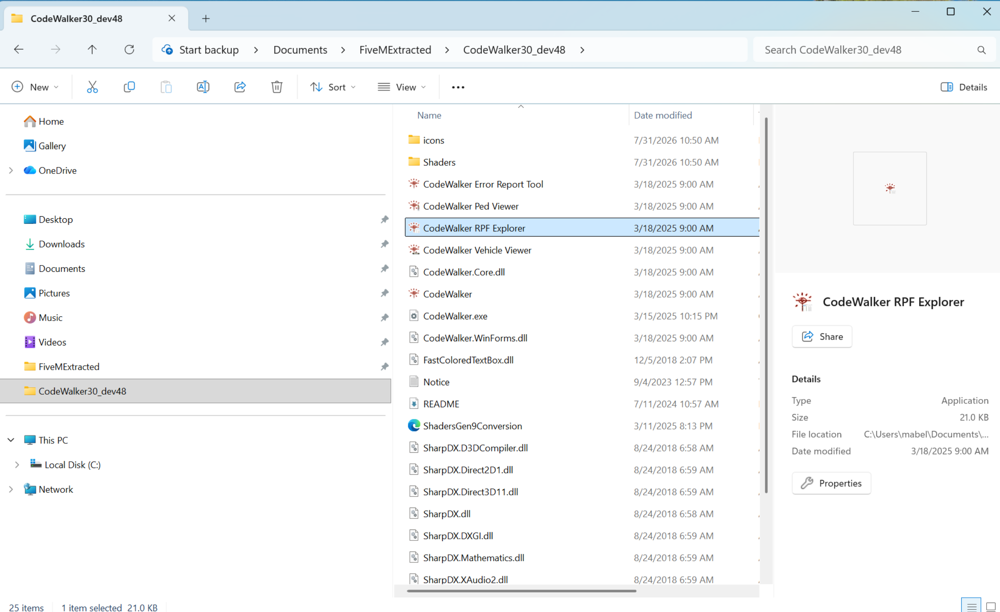
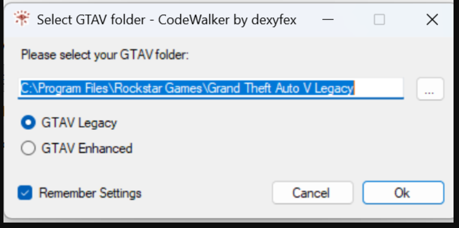
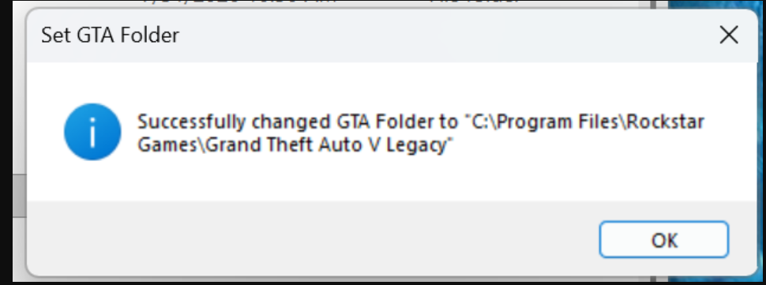
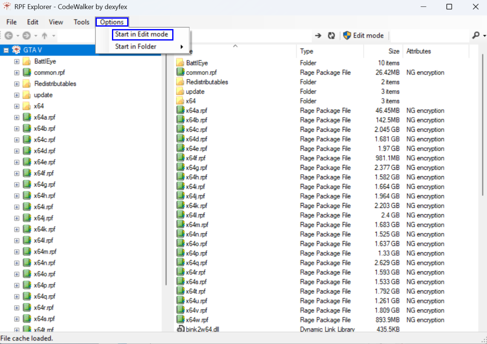
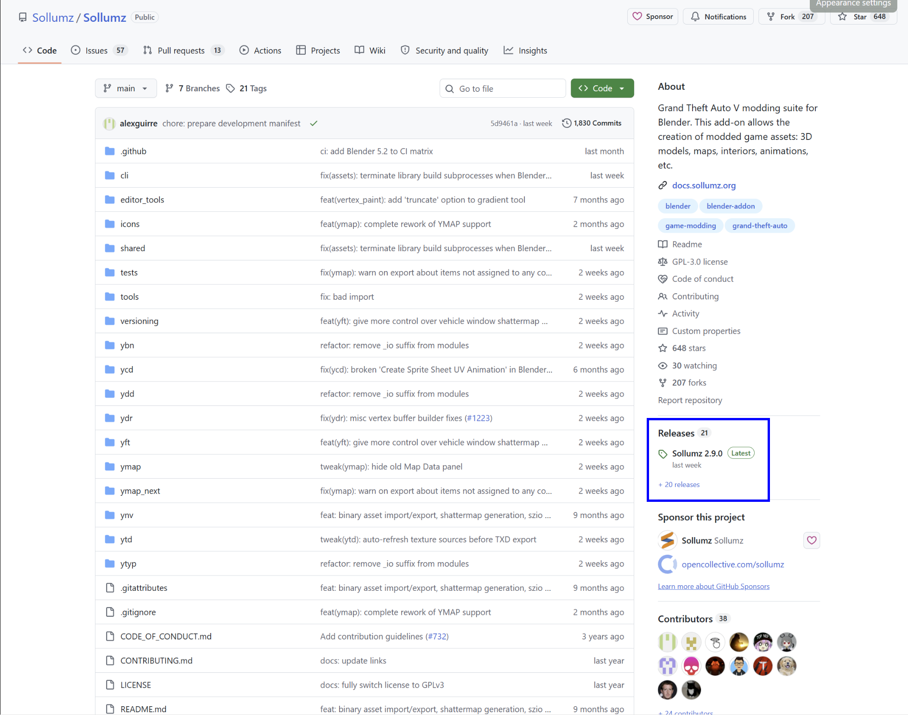
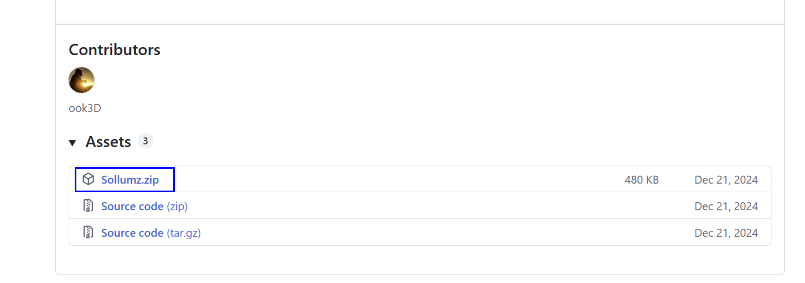
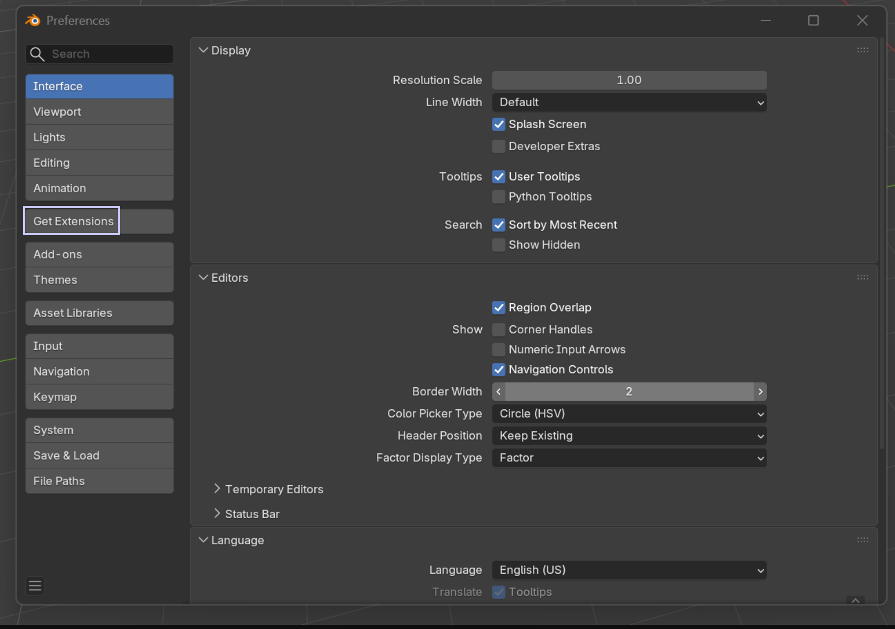
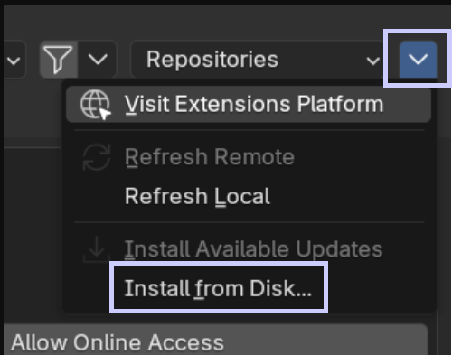

# Part 1 - Tooling & Workspace Setup

> Fuente original: https://docs.fivem.net/docs/assets-manual/beginner-series/part-1/ · repositorio `citizenfx/fivem-docs` @ `6ec9770` · copiado el 2026-10-20 · [índice de la documentación oficial](../../README.md)

🎬 Vídeo de YouTube: https://www.youtube.com/watch?v=GgZ82sue3kM

## What We'll Cover in This Part

- Downloading and installing CodeWalker
- Configuring CodeWalker for editing, including enabling Edit Mode
- Setting up nametables for proper asset loading
- Creating a custom RPF archive for future mods
- Installing Blender for 3D modeling
- Installing and configuring the Sollumz extension for GTAV asset creation

## Step 1: Download CodeWalker

1. Join the **[CodeWalker Discord](https://discord.gg/codewalker)**.
2. Locate the **#releases** channel and download the latest version of CodeWalker.\
   For this series, we're using version **Dev48**.
3. In the **#tips-documentation** channel, scroll up until you find the message for **"updated nametables"**.\
   Download the linked **RPF** file as well.

## Step 2: Set Up CodeWalker

1. Extract the downloaded ZIP somewhere on your computer.
2. Open the folder and launch **`CodeWalker RPF Explorer.exe`**.\
   
3. On first launch, it may prompt you to set the directory for your GTAV installation.\
   
   
4. Go to **Options** (top middle of the window) and **enable "Start in Edit Mode."**\
   
5. (Optional) Change to **Dark Mode** via: View -> Theme -> Dark

## Step 3: Create a New RPF Archive

1. Inside your GTAV root directory, create a **new RPF archive** using CodeWalker RPF Explorer, Right-click, New -> RPF Archive.\
   You can name this archive whatever you like - it will be used in future tutorials.
2. Place the previously downloaded **nametables.rpf** file in the **root** of your GTAV folder.
3. Make sure you are in **Edit Mode**, then **drag and drop** the nametables RPF file into your GTA folder inside the **RPF Explorer**.

## Step 4: Install Blender

1. Go to [**blender.org/download**](https://www.blender.org/download/) and download the latest version.\
   For this series, we're using version **4.5.4 LTS**.
2. Once installed, open **Blender**.

## Step 5: Install Sollumz Extension

We'll now install the **Sollumz** extension (used for GTAV asset creation).

1. Go to the official Sollumz [**GitHub Repository**](https://github.com/Sollumz/Sollumz/)
2. Select the Releases tab on the right, scroll down and download the `Sollumz.zip`.\
   
   
3. Inside Blender, go to Edit -> Preferences -> Get Extensions\
   
4. Top right, select the dropdown arrow and choose Install from Disk.
   
5. Install the Sollumz.zip file.
6. You will see an additional pop-up prompting you if you wish to install the pyMateria library, which allows for direct binary import & export.
7. If you wish to install the library, click Install, otherwise click Cancel. It is recommended to install it.

## Summary

You have now set up the **basic tools** required to start your GTAV 3D modding journey:

- CodeWalker
- Nametables
- Blender
- Sollumz Extension
