# Markers

> Fuente original: https://docs.fivem.net/docs/game-references/markers/ · repositorio `citizenfx/fivem-docs` @ `6ec9770` · copiado el 2026-10-20 · [índice de la documentación oficial](../README.md)

## Markers

<!-- _loc1_.map((name, idx) => ` ${idx} ${name}`).join('\n') -->

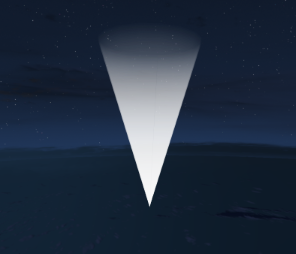 <strong>0</strong> MarkerTypeUpsideDownCone
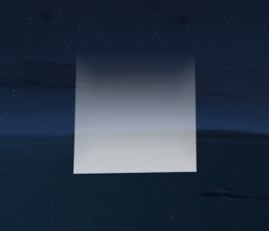 <strong>1</strong> MarkerTypeVerticalCylinder
 <strong>2</strong> MarkerTypeThickChevronUp
 <strong>3</strong> MarkerTypeThinChevronUp
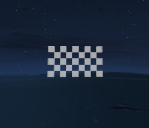 <strong>4</strong> MarkerTypeCheckeredFlagRect
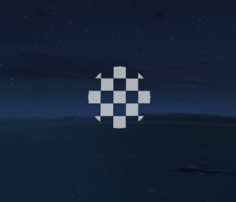 <strong>5</strong> MarkerTypeCheckeredFlagCircle
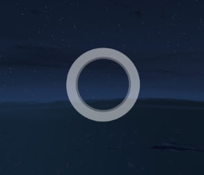 <strong>6</strong> MarkerTypeVerticleCircle
 <strong>7</strong> MarkerTypePlaneModel
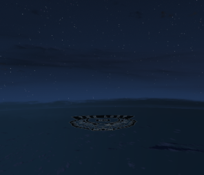 <strong>8</strong> MarkerTypeLostMCTransparent
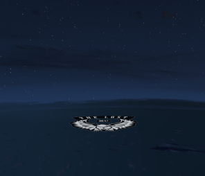 <strong>9</strong> MarkerTypeLostMC
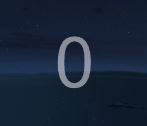 <strong>10</strong> MarkerTypeNumber0
 <strong>11</strong> MarkerTypeNumber1
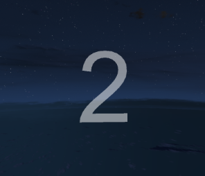 <strong>12</strong> MarkerTypeNumber2
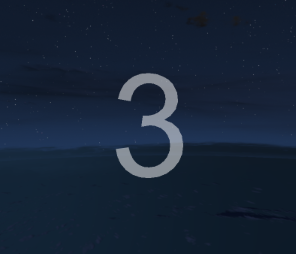 <strong>13</strong> MarkerTypeNumber3
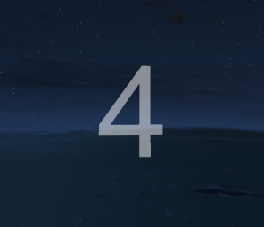 <strong>14</strong> MarkerTypeNumber4
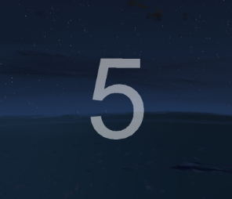 <strong>15</strong> MarkerTypeNumber5
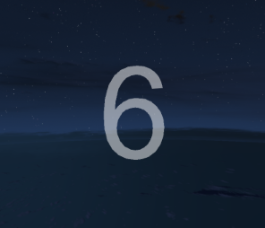 <strong>16</strong> MarkerTypeNumber6
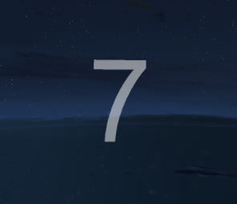 <strong>17</strong> MarkerTypeNumber7
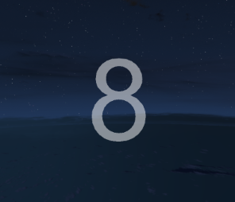 <strong>18</strong> MarkerTypeNumber8
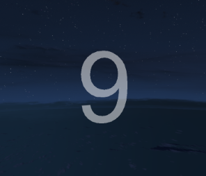 <strong>19</strong> MarkerTypeNumber9
 <strong>20</strong> MarkerTypeChevronUpx1
 <strong>21</strong> MarkerTypeChevronUpx2
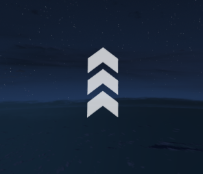 <strong>22</strong> MarkerTypeChevronUpx3
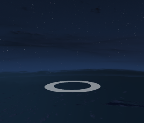 <strong>23</strong> MarkerTypeHorizontalCircleFat
 <strong>24</strong> MarkerTypeReplayIcon
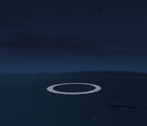 <strong>25</strong> MarkerTypeHorizontalCircleSkinny
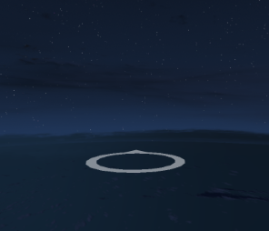 <strong>26</strong> MarkerTypeHorizontalCircleSkinny_Arrow
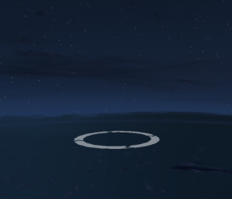 <strong>27</strong> MarkerTypeHorizontalSplitArrowCircle
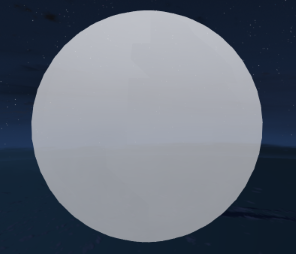 <strong>28</strong> MarkerTypeDebugSphere
 <strong>29</strong> MarkerTypeDollarSign
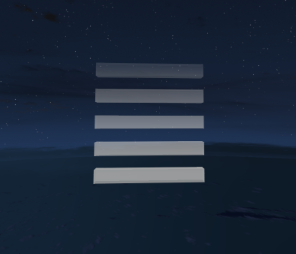 <strong>30</strong> MarkerTypeHorizontalBars
 <strong>31</strong> MarkerTypeWolfHead
 <strong>32</strong> MarkerTypeQuestionMark
 <strong>33</strong> MarkerTypePlaneSymbol
 <strong>34</strong> MarkerTypeHelicopterSymbol
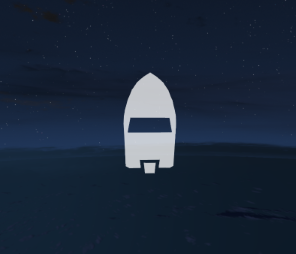 <strong>35</strong> MarkerTypeBoatSymbol
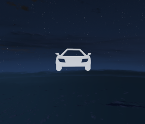 <strong>36</strong> MarkerTypeCarSymbol
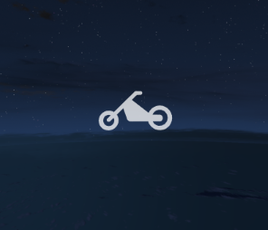 <strong>37</strong> MarkerTypeMotorcycleSymbol
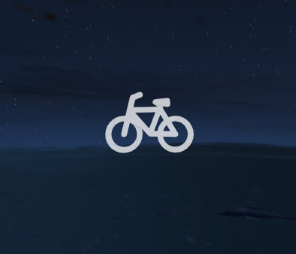 <strong>38</strong> MarkerTypeBikeSymbol
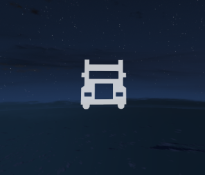 <strong>39</strong> MarkerTypeTruckSymbol
 <strong>40</strong> MarkerTypeParachuteSymbol
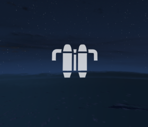 <strong>41</strong> ?
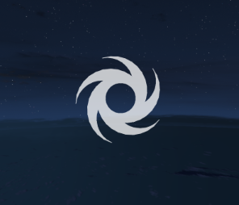 <strong>42</strong> MarkerTypeSawbladeSymbol
 <strong>43</strong> ?
