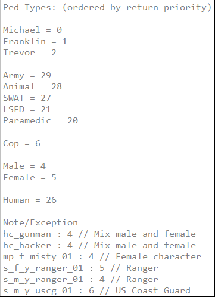

# onPlayerDied

> Fuente original: https://docs.fivem.net/docs/resources/baseevents/events/onPlayerDied/ · repositorio `citizenfx/fivem-docs` @ `6ec9770` · copiado el 2026-10-20 · [índice de la documentación oficial](../../../README.md)

## Name

```
baseevents:onPlayerDied
```

## Parameters

```
int killerType, array deathCoords
```

- **killerType**: The pedType of the ped that killed this player. (View the screenshot below for available pedTypes)
- **deathCoords**: An array containing the x, y, z coordinates of where the player died.

### Ped types



## Examples

### JavaScript Example:

```js
on('baseevents:onPlayerDied', (killerType, deathCoords) => {
   const [x, y, z] = deathCoords;
   console.log('died at:', { x, y, z });
});
```
