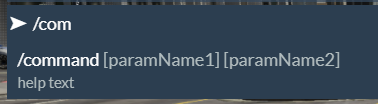

# chat:addSuggestion

> Fuente original: https://docs.fivem.net/docs/resources/chat/events/chat-addSuggestion/ · repositorio `citizenfx/fivem-docs` @ `6ec9770` · copiado el 2026-10-20 · [índice de la documentación oficial](../../../README.md)

## About

Triggering this event allows you to add command suggestions to your chat.

## Name

```
chat:addSuggestion
```

## Parameters

```
string commandName, string commandDescription, object commandParameters
```

## Examples

This example adds a command suggestion for the `/command` command.

### Lua Example:

```lua
-- Note, the command has to start with `/`.
TriggerEvent('chat:addSuggestion', '/command', 'help text', {
    { name="paramName1", help="param description 1" },
    { name="paramName2", help="param description 2" }
})
```

### C\# Example:

```csharp
TriggerEvent("chat:addSuggestion", "/command", "help text", new[]
{
    new { name="paramName1", help="param description 1" },
    new { name="paramName2", help="param description 2" }
});
```

### JS Example:

```js
setImmediate(() => {
  emit('chat:addSuggestion', '/command', 'help text', [
    {name:"paramName1", help:"param description 1"},
    {name:"paramName1", help:"param description 2"}
  ]);
});
```

## Example Result:


