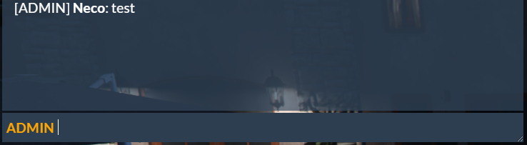

# registerMode

> Fuente original: https://docs.fivem.net/docs/resources/chat/exports/registerMode/ · repositorio `citizenfx/fivem-docs` @ `6ec9770` · copiado el 2026-10-20 · [índice de la documentación oficial](../../../README.md)

## About

Using this export allows you to add modes to your chat.

Mode object structure:

```lua
message = {
  name = name,
  displayName = displayName,
  color = color,
  seObject = seObject,
  cb = cb
}
```

## Name

```
registerMode
```

## Parameters

```
object modeData
```

## Examples

This example adds an admin chat for all players with the permission `admin.chat`.

### Lua Example:

```lua
exports.chat:registerMode({
  name = "adminChat",
  displayName = "Admin",
  color = "#fca503",
  seObject = "admin.chat",
  cb = function(source, message, cbs)
    cbs.updateMessage({
      template = "[ADMIN]" .. ' {}'
    })

    cbs.setSeObject("admin.chat")
  end
})
```

## Example Result:


