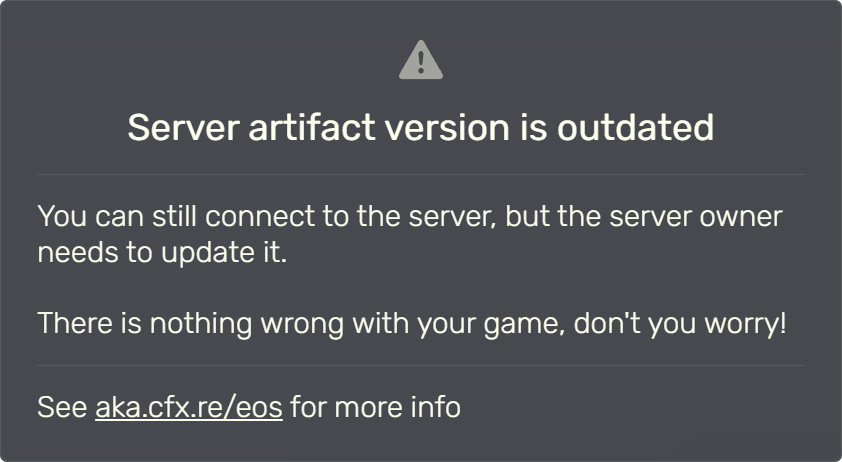
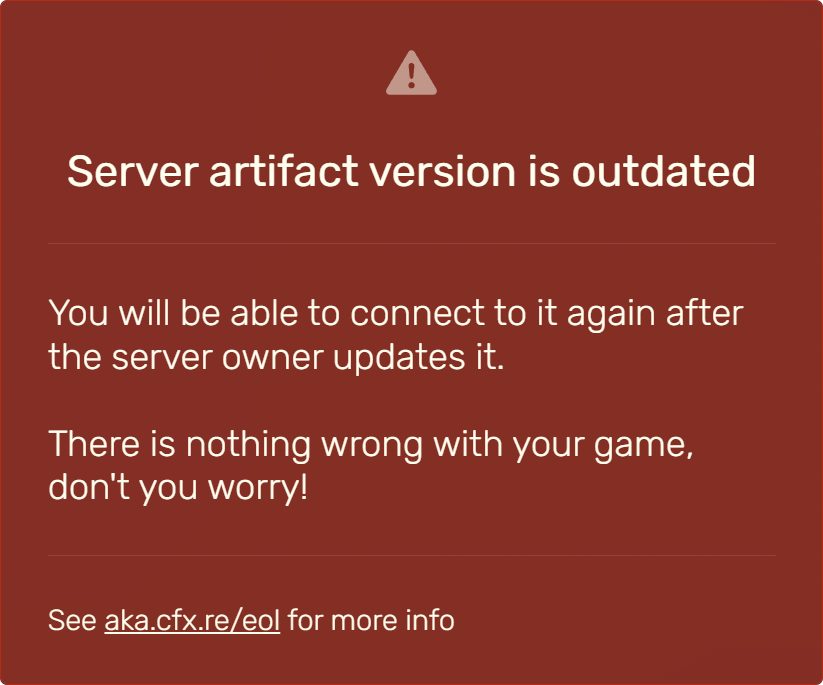
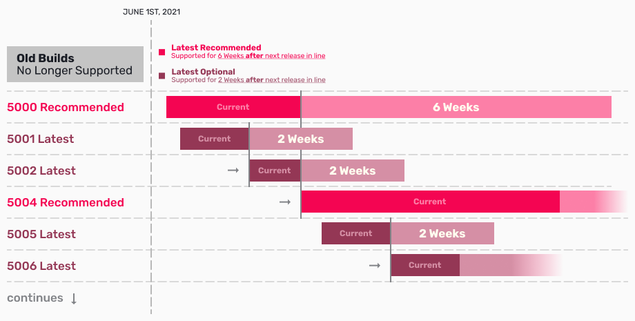

# End of Support/End of Life Warning Message

*>*

> Fuente original: https://docs.fivem.net/docs/server-manual/end-of-support-end-of-life/ · repositorio `citizenfx/fivem-docs` @ `6ec9770` · copiado el 2026-10-20 · [índice de la documentación oficial](../README.md)

You may see a message saying that the server which you are trying to join has reached end-of-support (EOS) or end-of-life (EOL). These warnings are shown to server owners and players when the server is running outdated FiveM/RedM artifacts.

  
  

## How to Resolve This as a Server Owner

To resolve this, update your FiveM/RedM server artifacts.

Server binaries can be downloaded [here](https://docs.fivem.net/docs/server-download/).

## What does this message mean for players?

Players don't need to take any action when this message appears while joining a server.
If a gray end-of-support (EOS) warning appears, the server is still joinable.
If a red end-of-life (EOL) warning appears and connection fails, the server owner must update their artifacts.
In case that happens, players should contact the server owner, inform them of the issue, and share this documentation.

## Server Artifact Support Timeline

To guarantee the best level of stability, we discontinue support for issues on outdated server artifacts.
We provide support schedules as outlined below:

Recommended artifacts are supported until six weeks after the next release in line.
Latest artifacts will be supported until two weeks after the next release in line.

Example: Support Timeline for Latest Optional Release

- Artifact 5001 is released on January 1.
- Artifact 5002 is released on January 6.
- We will provide support for artifact 5001 until January 6 + 14 days, thus January 20.

Outdated server artifacts will not stop functioning, however, we will not provide support for them. If you are experiencing issues, update to a newer server artifact before requesting support.

Unsupported server artifacts older than three months will not be joinable from the server browser. Please update your server's artifacts, and keep them up-to-date. If you are experiencing issues with newer server artifacts, always make sure to [report](https://forum.cfx.re/c/general-discussion/bug-reports/28) them.

## The Community is Here to Help

If you encounter any issues or have questions regarding server artifacts, the community is here to help. You can reach out to fellow server owners and players through our official [forums](https://forum.cfx.re/) and [Discord server](https://discord.gg/fivem). Sharing your experiences, problems and solutions can benefit the entire community.
