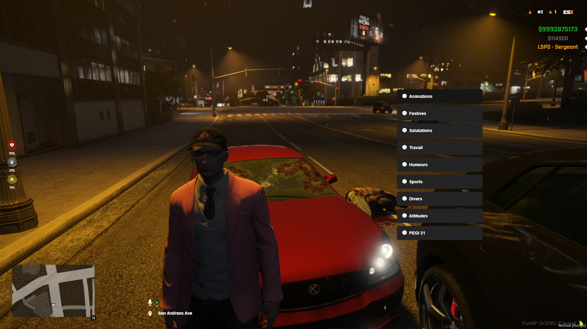

> Fuente original: https://github.com/esx-framework/esx-legacy-documenation/blob/031b7f7543db595e3a6503e822107b7f60ce14ec/src/pages/en/esx_addons/esx_animations.mdx · repositorio esx-framework/esx-legacy-documenation @ 031b7f7 · copiado el 2026-10-20

# esx_animations

This is a simple, lightweight script that allows players to perform animations in FiveM.
<br />

[Github Link](https://github.com/esx-framework/ESX-Legacy-Addons/tree/main/%5Besx_addons%5D/esx_animations)
<br />


## Configuration
    - Open Menu: `F3`
    - Stop Animation: `Z`

- Amimation Layout
```lua
Config.Animations = {
{
    name: string = 'category',
    label: string = 'Category',
    items = {
        {
            label: string = "Animation Name",
            type: string = "scenario", -- attitude, scenario, anim
            data = {
                anim: string = "anim_lib",
                lib: string = "lib_name"  -- Only for types "anim" and "attitude"
            }
        }
    },
}
}
```

## Exports

- `GetConfig`
  - ```lua
    local animations = exports['esx_animations']:GetConfig()
    ```
  - returns the configuration table

- `SetConfig`
  - ```lua
    exports['esx_animations']:SetConfig(animations)
    ```
  - sets the configuration table

## Requirements
- [es_extended](../esx_core/es_extended.md)
- [esx_context](../esx_core/esx_context.md)
