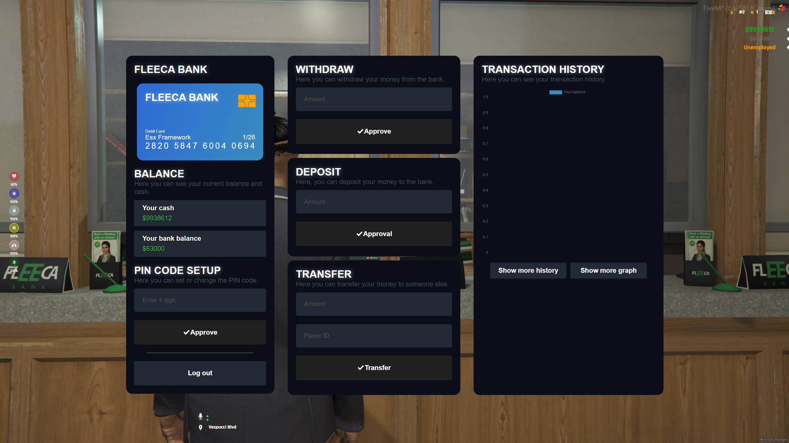

> Fuente original: https://github.com/esx-framework/esx-legacy-documenation/blob/031b7f7543db595e3a6503e822107b7f60ce14ec/src/pages/en/esx_addons/esx_banking.mdx · repositorio esx-framework/esx-legacy-documenation @ 031b7f7 · copiado el 2026-10-20

# esx_banking

A beautiful and Easy-To-Use Banking & ATM system for ESX
<br />

[Github Link](https://github.com/esx-framework/ESX-Legacy-Addons/tree/main/%5Besx_addons%5D/esx_banking)

<br />


## Configuration

- `Config.Debug`
    - type: `boolean`
    - default: `false`
    - description: Enable or disable debug mode
- `Config.DrawMarker`
    - type: `integer`
    - default: `10`
    - description: Draw distance for the marker
- `Config.EnablePeds`
    - type: `boolean`
    - default: `true`
    - description: Will spawn peds at the Banks
- `Config.AtmModels`
    - type: `table`
    - default: `{ "prop_atm_01", "prop_atm_02", "prop_atm_03", "prop_fleeca_atm" }`
    - description: List of ATM models
- `Config.Banks`
    - type: `table`
    - description: List of banks
`Config.Peds`
    - type: `table`
    - description: List of peds

### `Config.Banks` parameters

- `Position`
    - type: `vector4`
    - description: Bank position
- `Blip`
    - type: `table`
    - description: Bank blip
    - `Paramters`
        - `Enabled`
            - type: `boolean`
            - description: Enable or disable the blip
        - `Color`
            - type: `integer`
            - description: Blip color
        - `Label`
            - type: `string`
            - description: Blip name
        - `Sprite`
            - type: `integer`
            - description: Blip sprite
        - `Scale`
            - type: `float`
            - description: Blip scale

### `Config.Peds` parameters

- `Position`
    - type: `vector4`
    - description: Ped position
- `Model`
    - type: `hash`
    - description: Ped model
- `Scenario`
    - type: `string`
    - description: Ped scenario to play

## API

### Client

```lua
TriggerServerEvent("esx_banking:logTransaction",label, logType, amount)
```

**Example:**

```lua
TriggerServerEvent("esx_banking:logTransaction","TAX", "DEPOSIT", 2000)
```

### Server

```lua
exports["esx_banking"]:logTransaction(source,label,logType,amount)
```

**Example:**

```lua
exports["esx_banking"]:logTransaction(source,"CAR PURCHASE","WITHDRAW",200)
```
