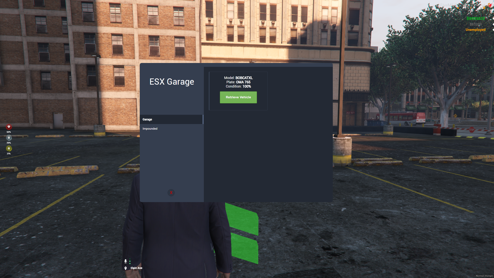

> Fuente original: https://github.com/esx-framework/esx-legacy-documenation/blob/031b7f7543db595e3a6503e822107b7f60ce14ec/src/pages/en/esx_addons/esx_garage.mdx · repositorio esx-framework/esx-legacy-documenation @ 031b7f7 · copiado el 2026-10-20

# esx_garage

[Github Link](https://github.com/esx-framework/ESX-Legacy-Addons/tree/main/%5Besx_addons%5D/esx_garage)

Store Your vehicles in style! ESX garage has an amazing New UI to help you be stylish while parking your broken, rusty Nissan Micra!
<br />


## Configuration

- `Config.DrawDistance`
    - type: float
    - default: 10.0
    - description: The distance in which the garage marker will be drawn.
- `Config.Markers`
    - type: table
    - description: The markers that will be drawn on the map.
    - Parameters:
        - `type`
            - type: integer
            - description: The type of the marker.
        - `size`
            - type: table
            - parameters:
                - x: float
                - y: float
                - z: float
            - description: The size of the marker.
        - `color`
            - type: rgba
            - description: The color of the marker.
- `Config.Garges`
    - type: table
    - description: The garages that will be drawn on the map.
    - layout:
```lua
Config.Garages = {
	GarageName = {
        EntryPoint = {x = 0.0, y = 0.0, z = 0.0},
        SpawnPoint = {x = 0.0, y = 0.0, z = 0.0, heading = 0.0},
        Sprite = 357,
		Scale = 0.8,
		Colour = 3,
		ImpoundedName = "impoundName"
    }
}
```
- `Config.Impounds`
    - type: table
    - description: The impounds that will be drawn on the map.
    - layout:
```lua
Config.Impounds = {
    ImpoundName = {
        GetOutPoint = {x = 0.0, y = 0.0, z = 0.0},
        SpawnPoint = {x = 0.0, y = 0.0, z = 0.0, heading = 0.0},
        Sprite = 357,
        Scale = 0.8,
        Colour = 3,
        Cost = 3000,
    }
}
```

## Exports

### `getGarages`

Returns the `Config.Garages` table.

```lua
local garages = exports['esx_garage']:getGarages()
```

### `getImpounds`

Returns the `Config.Impounds` table.

```lua
local impounds = exports['esx_garage']:getImpounds()
```
