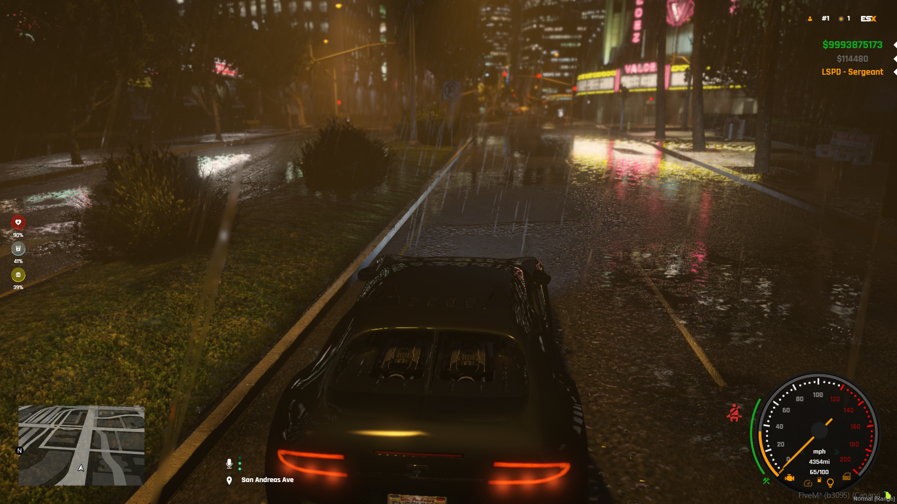

> Fuente original: https://github.com/esx-framework/esx-legacy-documenation/blob/031b7f7543db595e3a6503e822107b7f60ce14ec/src/pages/en/esx_addons/esx_hud.mdx · repositorio esx-framework/esx-legacy-documenation @ 031b7f7 · copiado el 2026-10-20

# esx_hud

A clean, modern HUD that's easy to customise and configure. Integrated mileage calculation and more.
[Github Link](https://github.com/esx-framework/ESX-Legacy-Addons/tree/main/%5Besx_addons%5D/esx_hud)
 

## Features
 - Mileage calculation system
 - Indicator system with sound effect
 - Weapon HUD with ammo counter
 - Online player counter
 - Job label
 - Switch to mph or kmh
 - Color picker that allows you to customize the interface
 - Settings panel for additional settings
 - Different speedo layouts depending on vehicle type(LAND,AIR)
 - Seatbelt system with sound effect

## Requirements
- [es_extended](../esx_core/es_extended.md)
- [esx_cruisecontrol](esx_cruisecontrol.md) *(Optional, for seatbelt functionality)*
