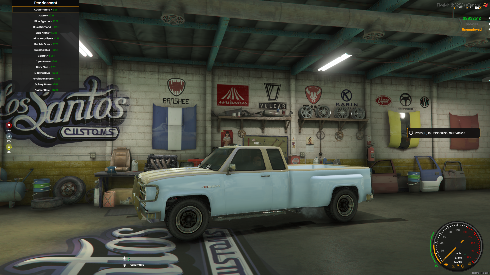

> Fuente original: https://github.com/esx-framework/esx-legacy-documenation/blob/031b7f7543db595e3a6503e822107b7f60ce14ec/src/pages/en/esx_addons/esx_lscustom.mdx · repositorio esx-framework/esx-legacy-documenation @ 031b7f7 · copiado el 2026-10-20

# esx_lscustom

[Github Link](https://github.com/esx-framework/ESX-Legacy-Addons/tree/main/%5Besx_addons%5D/esx_lscustom)

ESX LSCustom is a resource which enables GTA's LSCustoms. it allows players to customize their vehicles however they want to.
<br />


## Configuration

- `Config.DrawDistance`
    - type: `float`
    - default: `10.0`
    - description: The distance in which the LSCustoms marker is drawn.
- `Config.IsMechanicJobOnly`
    - type: `bool`
    - default: `false`
    - description: If set to true, only players with the mechanic job can access LSCustoms.
- `Config.Zones`
    - type: `table`
    - description: The list of LSCustoms locations.
    - layout:
- `Config.DefaultWheelsPriceMultiplier`
    - type: `integer`
    - default: `2`
    - description: The default price multiplier for wheels.
```lua
Config.Zones = {
	ls1 = {
		Pos   = vector3(-337.38, -136.92, 38.57),
		Name  = TranslateCap('blip_name'),
		Hint  = TranslateCap('press_custom')
	},
}
```
- `Config.Colours`
    - type: `table`
    - description: The list of colours that can be used in LSCustoms.
    - layout:
```lua
Config.Colors = {
	{label = TranslateCap('black'), value = 'black'},
     --[...] Rest of the colours
}
```
