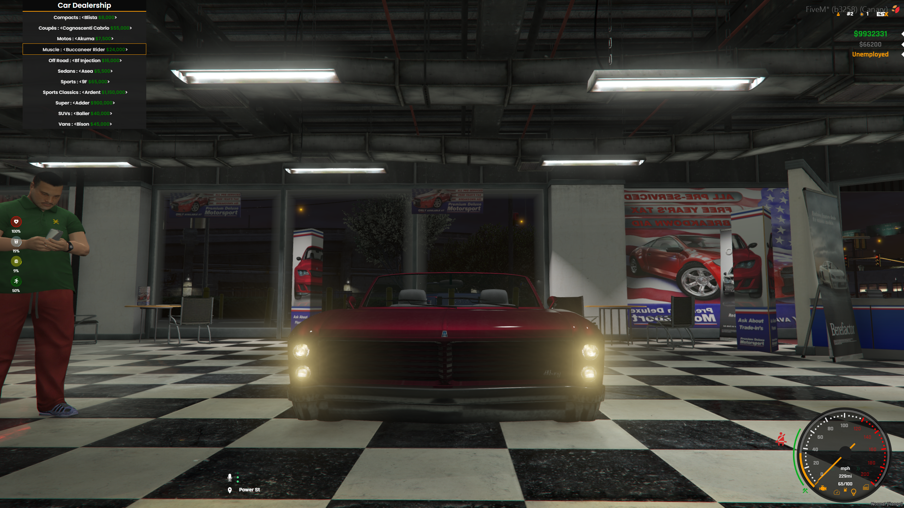

> Fuente original: https://github.com/esx-framework/esx-legacy-documenation/blob/031b7f7543db595e3a6503e822107b7f60ce14ec/src/pages/en/esx_addons/esx_vehicleshop.mdx · repositorio esx-framework/esx-legacy-documenation @ 031b7f7 · copiado el 2026-10-20

# esx_vehicleshop

[Github Link](https://github.com/esx-framework/ESX-Legacy-Addons/tree/main/%5Besx_addons%5D/esx_vehicleshop)

ESX Vehicle Shop adds an vehicle shop to the game, where employeed players can sell vehicles to other players.
You can also disable the job part so any player can buy vehicles with a menu based interaction.
<br />


## Configuration

- `Config.DrawDistance`
  - type: `integer`
  - default: `10`
  - description: The distance in which the marker is drawn.
- `Config.MarkerColor`
  - type: `table`
  - default: `{r = 120, g = 120, b = 240}`
  - description: The color of the marker.
- `Config.EnablePlayerManagement`
  - type: `boolean`
  - default: `false`
  - description: Enable or disable car dealer job.
- `Config.LicenseEnable`
  - type: `boolean`
  - default: `true`
  - description: Enable or disable requiring a license to buy vehicles.
- `Config.PlateLetters`
  - type: `integer`
  - default: `3`
  - description: The amount of letters in the license plate. (total plate is 8 characters)
- `Config.PlateNumbers`
    - type: `integer`
    - default: `3`
    - description: The amount of numbers in the license plate. (total plate is 8 characters)
- `Config.PlateUseSpace`
    - type: `boolean`
    - default: `true`
    - description: Use space in the license plate. (note: count as a character)
- `Config.Blip`
    - type: `table`
    - description: Blip settings.
    - `Config.Blip.show`
        - type: `boolean`
        - default: `true`
        - description: Blip sprite.
    - `Config.Blip.Sprite`
        - type: `integer`
        - default: `326`
        - description: Blip sprite.
    - `Config.Blip.Display`
      - type: `integer`
      - default: `4`
      - description: Blip Display.
    - `Config.Blip.Scale`
        - type: `float`
        - default: `0.8`
        - description: Blip scale.
- `Config.Zones`
    - type: `table`
    - description: List of zones.
    - layout:
```lua
Config.Zones = {
   zoneName = {
        Pos = vector3(x, y, z),
        Size = {x = 1.5, y = 1.5, z = 1.0},
        Type = 1, -- (1 = show marker, -1 = hide marker)
   }
}
```
