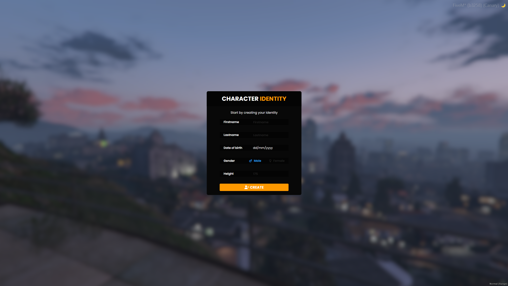

> Fuente original: https://github.com/esx-framework/esx-legacy-documenation/blob/031b7f7543db595e3a6503e822107b7f60ce14ec/src/pages/en/esx_core/esx_identity.mdx · repositorio esx-framework/esx-legacy-documenation @ 031b7f7 · copiado el 2026-10-20

# esx_identity

A script that allows the player to pick their characters name, gender, height and date of birth. Used by [es_extended](es_extended.md) and [esx_multicharacter](esx_multicharacter.md)

<br />

<br />

### Show Identity registration menu
Show the identity registration menu

**Example**
```lua
TriggerEvent("esx_identity:showRegisterIdentity")
```

### Listen to when a player completed the identity registration
Listen to when a player completed the identity registration. Server Only

**Arguments**
- data: `table`
  - The information of the registered identity.

***data***
- firstname: `string`
  - The first name of the player.
- lastname: `string`
  - The last name of the player.
- dateofbirth: `string`
  - The date of birth of the player.
- sex: `string`
  - The sex of the player. Either m for male or f for female
- height: `number`
  - The height of the player.

**Example**
```lua
AddEventHandler("esx_identity:completedRegistration", function(source, data)
  print("Player with source " .. source .. " has registered their identity. And is called " .. data.firstname .. " " .. data.lastname)
end)
```
