> Fuente original: https://github.com/esx-framework/esx-legacy-documenation/blob/031b7f7543db595e3a6503e822107b7f60ce14ec/src/pages/en/tutorial/install.mdx · repositorio esx-framework/esx-legacy-documenation @ 031b7f7 · copiado el 2026-10-20

# Installing ESX Legacy

This guide covers installing **ESX Legacy** using txAdmin — the recommended method for deploying a stable FiveM server with the ESX framework.

> **Nota:** **What is ESX Legacy?**  
> ESX Legacy is the official, actively maintained version of the ESX framework. It provides a complete roleplay foundation including jobs, inventory, housing, and banking systems.

## Before You Begin

Ensure you have the following ready:

| Requirement | Details |
|-------------|---------|
| **cfx.re Account** | Required for server registration and license keys. [Create one →](https://cfx.re/) |
| **MariaDB** | ESX requires a MySQL-compatible database. [Download MariaDB →](https://mariadb.org/download/) |
| **Windows PC or Server** | This guide covers Windows installation |
| **~10 GB free disk space** | For server artifacts, resources, and database files |

> **Advertencia:** **Do not use XAMPP.** It is outdated, unstable for production servers, and has been known to cause data loss. Use MariaDB only.

---

## Step 1: Download Server Artifacts

Server artifacts are the core files that power your FiveM server.

1. Go to [artifacts.jgscripts.com](https://artifacts.jgscripts.com)
   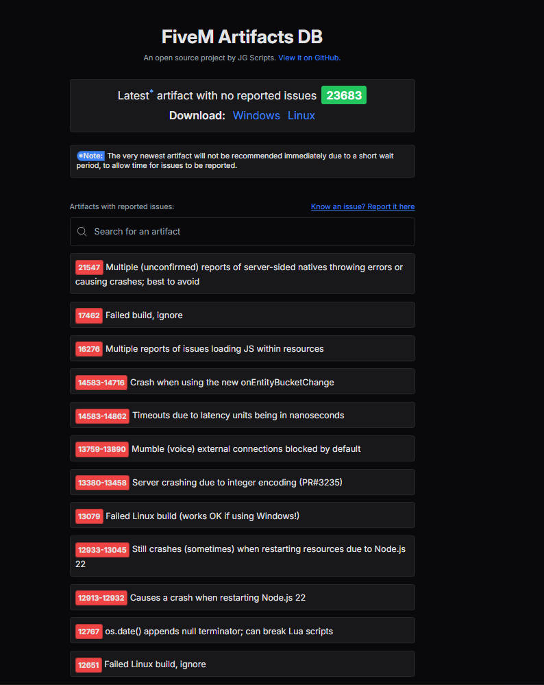
2. Click **Windows** to automatically download the latest recommended artifacts
   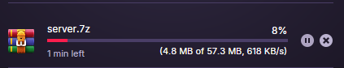
3. Extract the archive to a **permanent** location  
   **Recommended:** `C:\FiveM Server\` or `Documents\FiveM Server`
   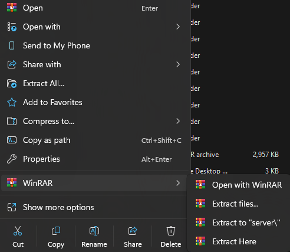

> **Advertencia:** Choose your server location carefully. Moving the folder later requires updating multiple absolute paths in `server.cfg` and txAdmin.

## Step 2: Run Initial Setup

1. Open your extracted server folder and locate `FXServer.exe`
   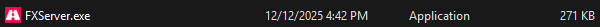
2. Run `FXServer.exe`  
   - *If your antivirus flags the file, it is a false positive. Add an exception and allow it to run.*
3. A browser tab will open with the txAdmin setup wizard
4. Click **Link Account** and sign in with your cfx.re credentials
   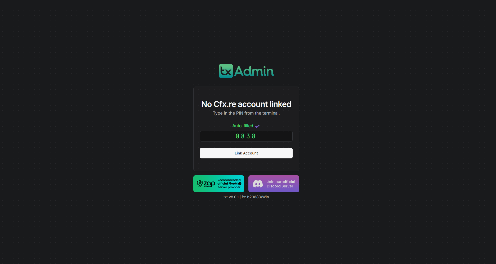
5. Create a **Backup Password** in case you are ever logged out of your cfx.re account
   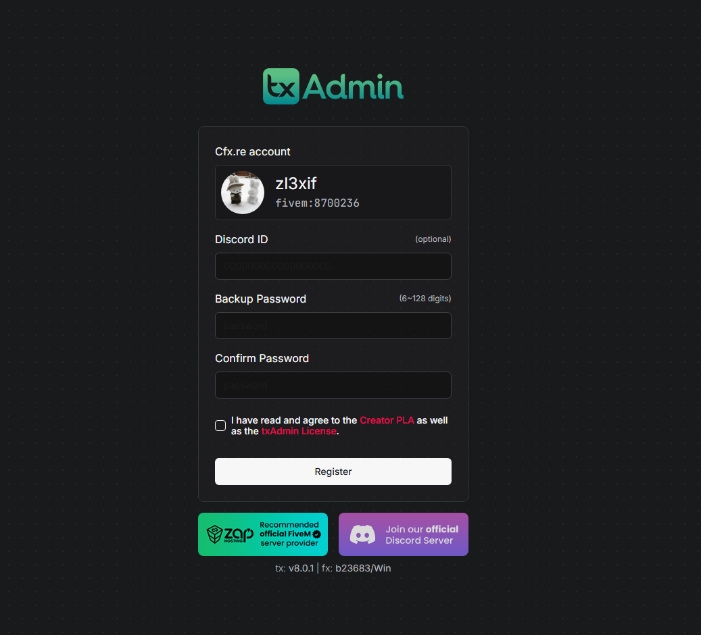
6. Click **Next**

## Step 3: Configure Server Details

1. Enter your **Server Name** — this appears publicly in the FiveM server list
   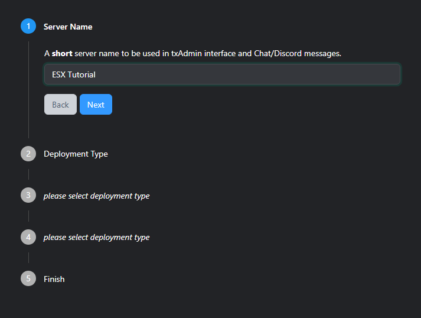
2. For **Deployment Type**, select **Popular Recipes**
   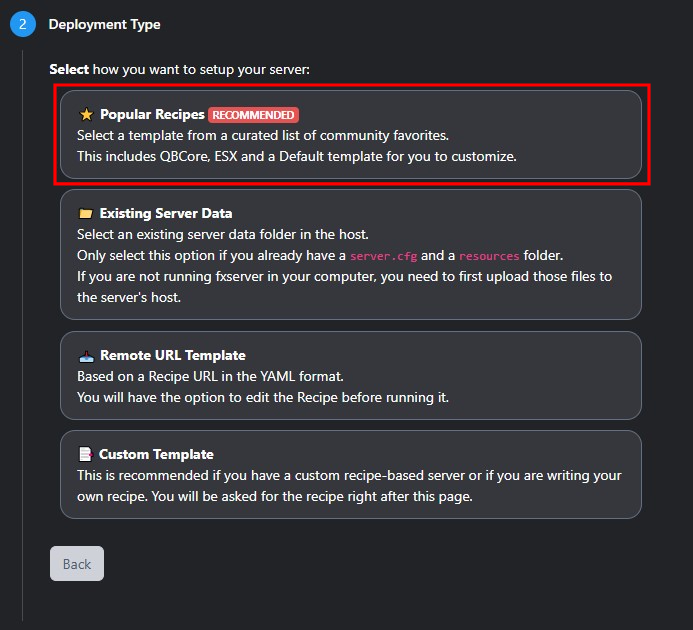
3. Choose **ESX Legacy** from the recipe list
   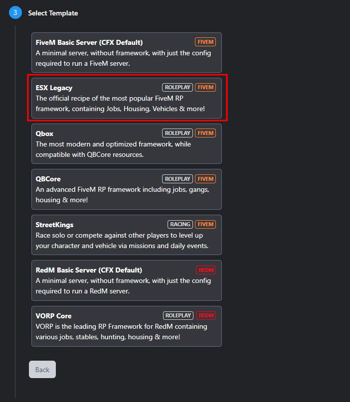
4. When prompted for the **Resource Path**, change the default to a dedicated folder for easier management
   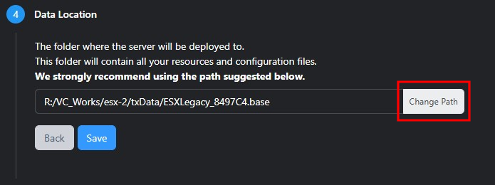
5. Ensure the folder exists at the location you specify before continuing
   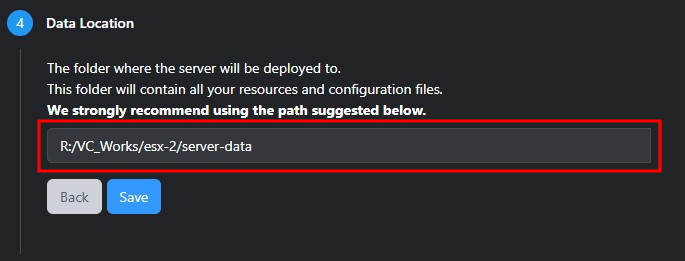

> **Nota:** txAdmin will not create missing directories automatically. Create the folder beforehand to avoid deployment errors.

## Step 4: Connect the Database

ESX stores all player data, inventories, jobs, and vehicles in MariaDB.

1. Confirm MariaDB is installed and the MySQL service is running
2. In txAdmin, open the **Recipe Deployer**
   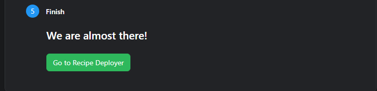
3. Enter your database credentials:
   - **Host:** `localhost`
   - **Port:** `3306`
   - **User:** Your MariaDB username (e.g., `root`)
   - **Password:** Your MariaDB password
   - **Database:** `esx_legacy` (or your preferred name)

## Step 5: Add Your License Key

A valid CFX license key is required for your server to accept connections.

1. On the **Review Recipe** page, locate the license key field
   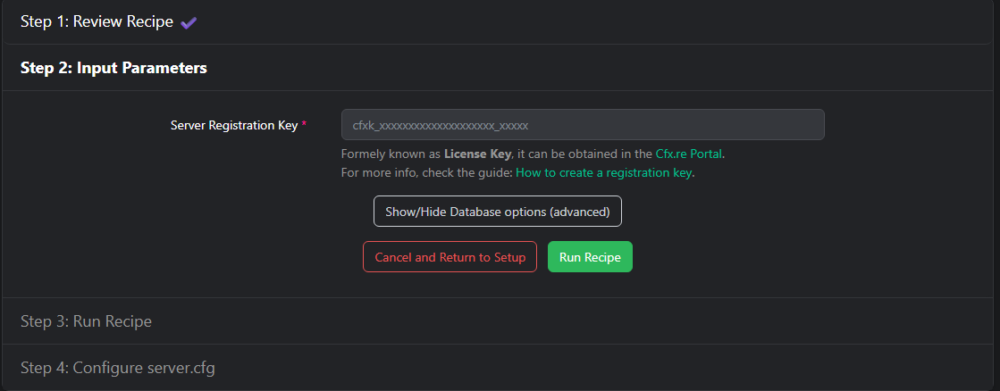
2. Visit [portal.cfx.re/servers/registration-keys](https://portal.cfx.re/servers/registration-keys)
3. Generate a new key and copy it
4. Paste the key into txAdmin and click **Next**

> **Peligro:** **Never share your CFX license key.** Keys are tied to your account and server identity. Sharing them violates CFX terms of service and can compromise your server.

## Step 6: Deploy

1. Click **Run Recipe** to start the automated ESX Legacy deployment
2. Review the generated `server.cfg` to adjust max players, server tags, and locale as needed
3. Click **Next** to finalize
   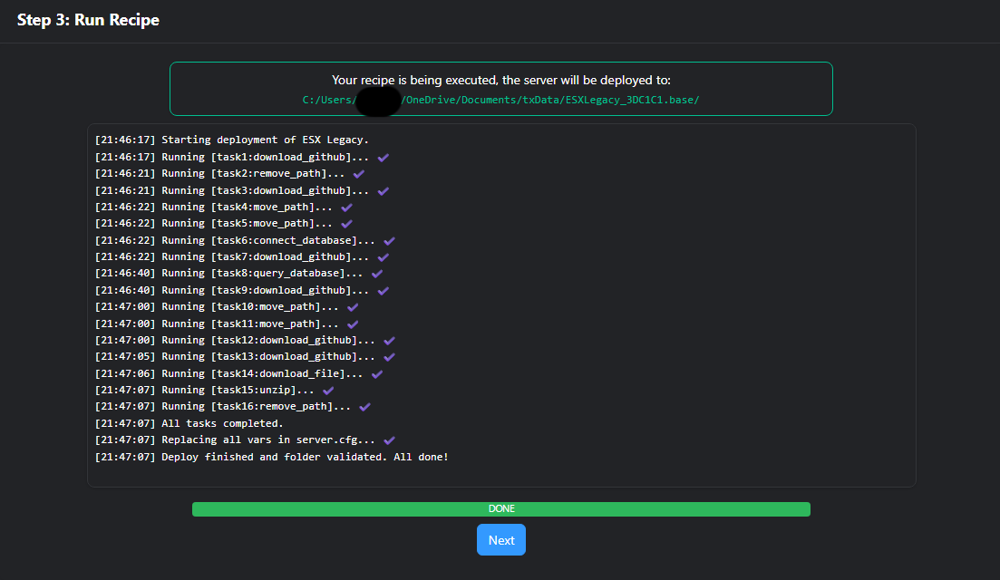

Your ESX Legacy server is now installed.

---

## Post-Installation Checklist

- [ ] Start the server and verify it appears in the FiveM server list
- [ ] Join locally via `localhost:30120` to test character creation and core features
- [ ] Bookmark your txAdmin URL for ongoing server management
- [ ] Create a dedicated MariaDB user for ESX instead of using `root` (security best practice)

## Troubleshooting

| Issue | Cause & Solution |
|-------|------------------|
| **Antivirus blocks `FXServer.exe`** | False positive. Add your server folder to antivirus exclusions. |
| **Database connection failed** | MariaDB service is not running, or credentials are incorrect. Check Windows Services and verify your password. |
| **License key rejected** | Key is invalid or belongs to another account. Generate a fresh key at [portal.cfx.re](https://portal.cfx.re/). |
| **Recipe deployment fails** | Resource path does not exist, or txAdmin lacks write permissions. Run as administrator if needed. |
| **Server not visible in list** | Invalid license key, or port `30120` is blocked by Windows Firewall. |

## Next Steps

Once your server is running, you can:

- **Add Jobs & Gangs** — Configure `esx_jobs` or install compatible job scripts
- **Import Vehicles** — Add vehicle packs via `esx_vehicleshop` or standalone resources
- **Install Addons** — Browse housing, phone, and banking scripts from the ESX ecosystem
- **Optimize Performance** — Review `server.cfg` tick rates and monitor resource load order

> **Consejo:** Need help with a specific ESX addon? Check the dedicated documentation sections for individual resources on this site.
