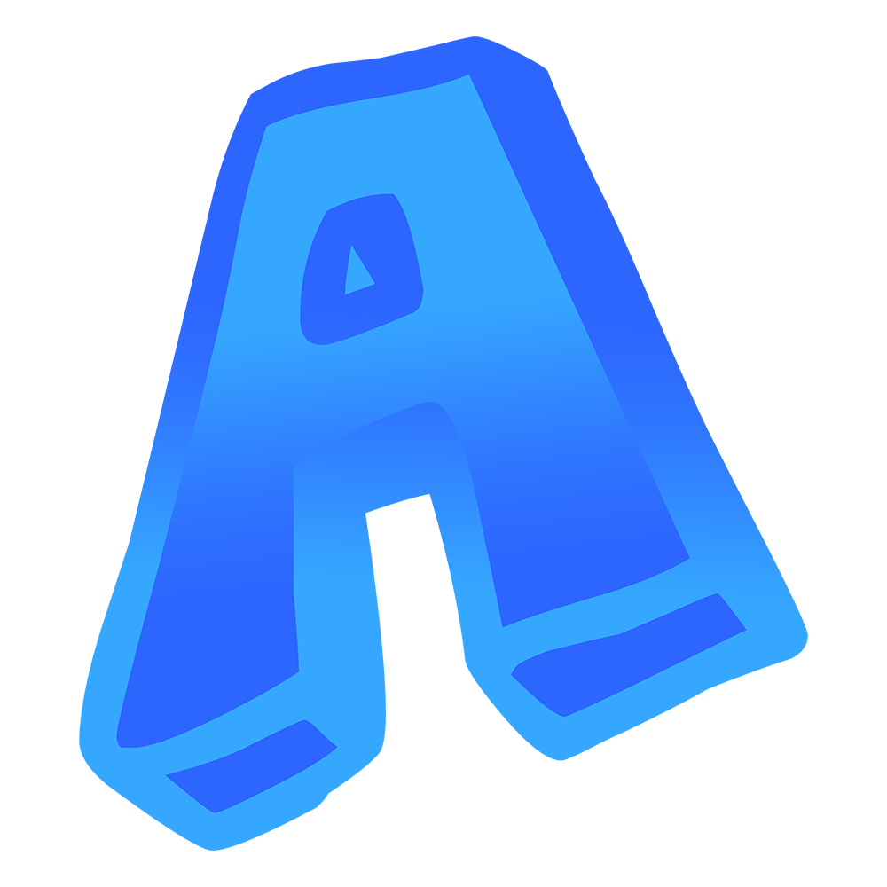
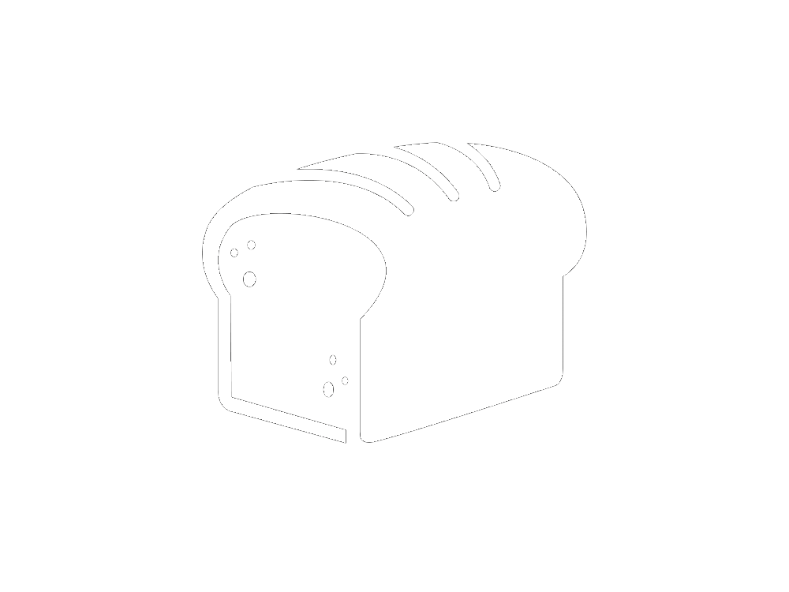
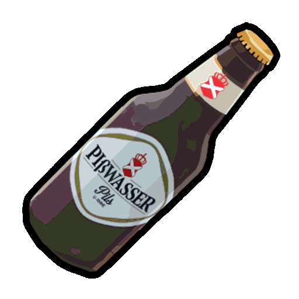
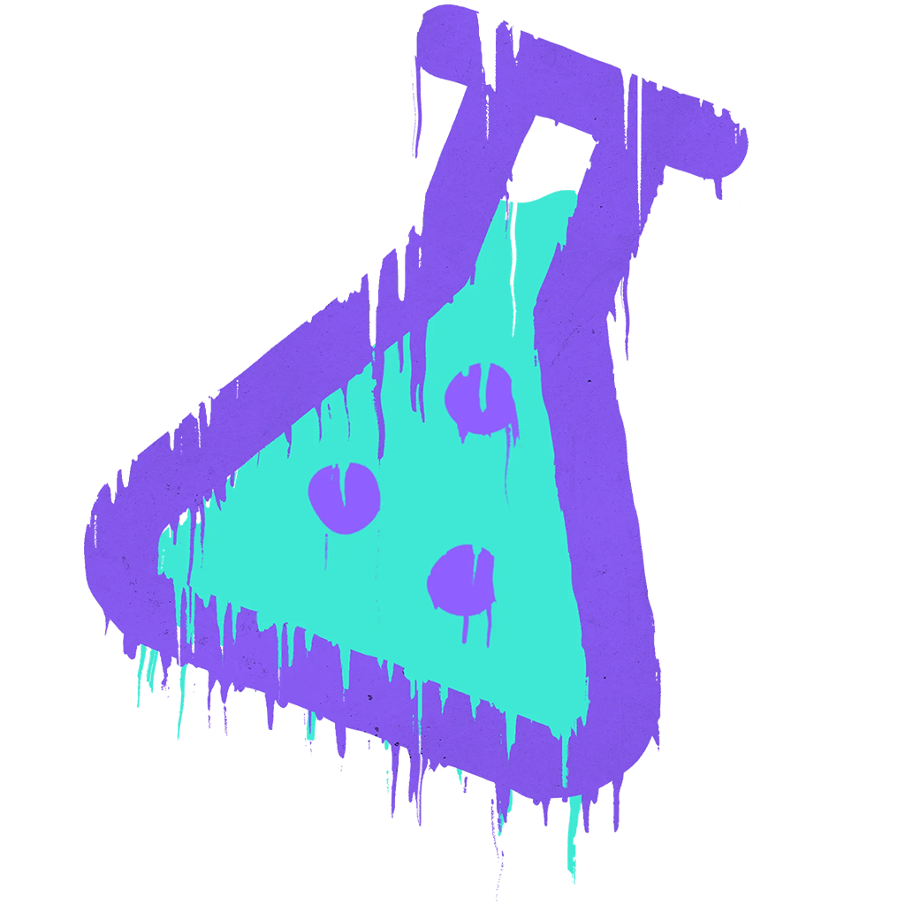
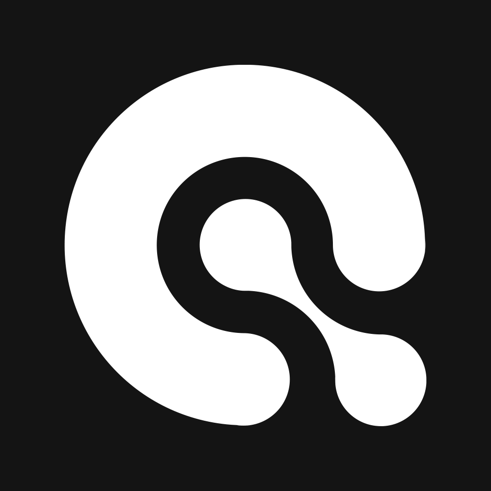
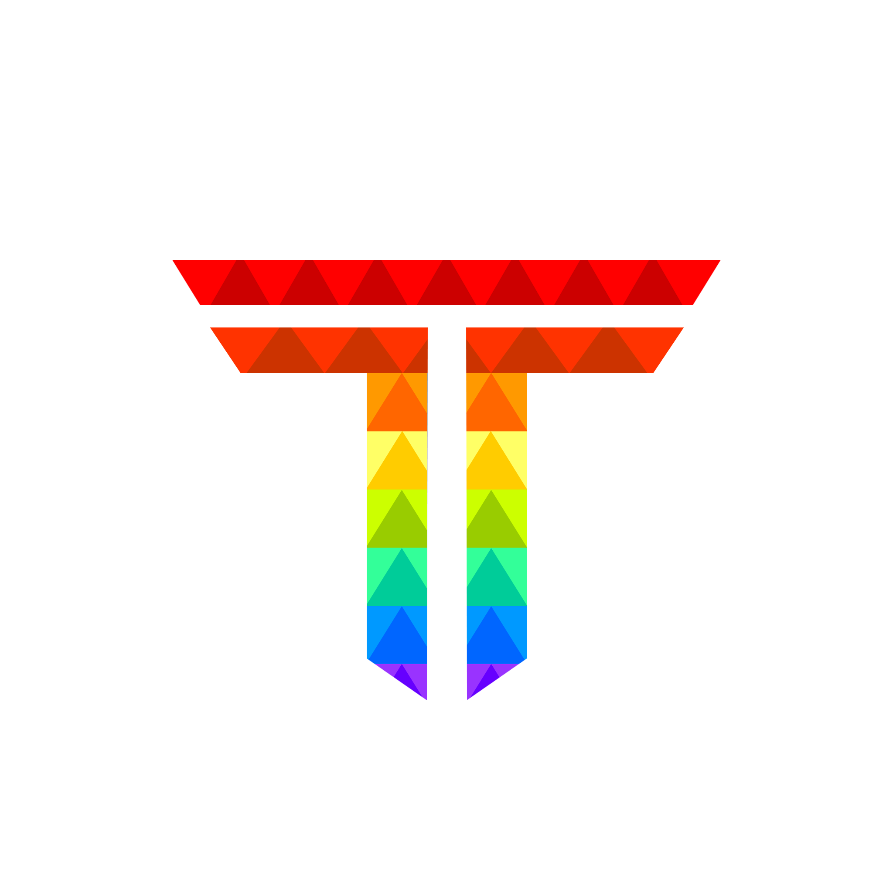
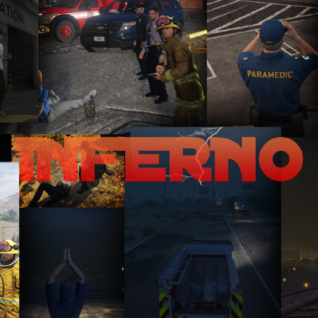

> Fuente original: https://github.com/overextended/docs/blob/328e36feb5b0486d6214971f53c6d2626193cc28/content/docs/index.mdx · repositorio overextended/docs @ 328e36f · copiado el 2026-10-20

# Documentation

## Developer Resources

- [Fivemanage](resources/fivemanage.md)
- [Prism Host](resources/prism-host.md)
- [Templates](resources/templates.md)

## Creator Codes

*(Contenido incluido desde [Tebex Creators](resources/tebex-creators.md))*

Creator codes allow Tebex stores to share revenue with other creators, giving a discount to the customer at the same time.
We make these deals to advertise trusted creators who meet our criteria.

- The creator is reputable and provides quality customer service.
- The creator understands and respects [open source](https://opensource.org/) licenses.
- Resources follow best practices and are highly configurable or source-available.

You can apply a creator code at checkout under "Support A Creator".

| Creator | Store | Creator code | Discount | Logo |
| --- | --- | --- | --- | --- |
| Andyyy | <https://andyyy.tebex.io/> | `ox20` | 20% |  |
| Berkie's Workshop | <https://berkie.tebex.io/> | `ox10` | 10% |  |
| Dolu Mods | <https://dolu.tebex.io/> | `overextended` | 25% |  |
| Electus Scripts | <https://store.electus-scripts.com/> | `ox10` | 10% |  |
| Loaf Scripts | <https://store.loaf-scripts.com/> | `ox10` | 10% |  |
| OT Studios | <https://store.otstudios.net/ox> | `ox10` | 10% |  |
| Randolio Scripts | <https://randolio.tebex.io/> | `OVEREXTENDED` | 20% |  |
| rcore | <https://store.rcore.cz/> | `ox10` | 10% |  |
| Artwork Inventory | <https://artwork-inventory.tebex.io/> | `ox10` | 10% |  |
| Renewed Scripts | <https://renewed.tebex.io/ox> | `ox15` | 15% |  |
| Scuffed Labs | <https://scuffedlabs.com/> | `overextended` | 10% |  |
| RAHE Development | <https://rahe.tebex.io/> | `ox10` | 10% |  |
| Qwaly Scripts | <https://qwaly.dev/> | `ox10` | 10% |  |
| Ehbw Scripts | <https://ehbw.tebex.io/> | `ox10` | 10% |  |
| Lation Scripts | <https://lationscripts.com/> | `ox10` | 10% |  |
| Fuksus | <https://resources.fuksus.com/> | `OX15` | 15% |  |
| TeamsGG | <https://teamsgg.dev/> | `ox10` | 10% |  |
| MadCap Scripts | <https://madcap-scripts.tebex.io/> | `ox10` | 10% |  |
| Stevo Scripts | <https://store.stevoscripts.com/> | `overextended` | 10% |  |
| Inferno Collection | <https://store.inferno-collection.com/> | `ox7` | 7% |  |
