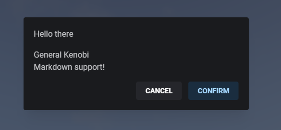

> Fuente original: https://github.com/overextended/docs/blob/328e36feb5b0486d6214971f53c6d2626193cc28/content/docs/ox_lib/Interface/Client/alert.mdx · repositorio overextended/docs @ 328e36f · copiado el 2026-10-20

# Alert Dialog

Simple alert dialog that can display a message to the player.  
Returns whether the player pressed the confirm button or canceled the dialog.

## lib.alertDialog

**Lua**

**Client**

```lua
lib.alertDialog(data)
```

**Server**

```lua
TriggerClientEvent('ox_lib:alertDialog', source, data)
```

**JS**

> **Nota:** This function is **asynchronous** requiring you to do a `.then` callback on the promise or make your function `async`.

    ```ts
    import lib from '@overextended/ox_lib/client';

    lib.alertDialog(data);
    ```

- data: `table` (`object`)
  - header: `string`
    - Dialog title.
  - content: `string`
    - Dialog body content, supports markdown.
  - centered?: `boolean`
    - Centers the dialog vertically and horizontally.
  - cancel?: `boolean`
    - Displays a cancel button (ESC is still available if this is not defined).
  - size?: `'xs'` or `'sm'` or `'md'` or `'lg'` or `'xl'`
  - overflow?: `boolean`
  - labels?: `table`
    - Allows you to define the displayed labels for cancel and/or confirm buttons.
    - cancel?: `string`
    - confirm?: `string`

Returns `'confirm'` if the player pressed the confirm button, otherwise if the player pressed the cancel button
or has exited the dialog with ESC the return will be `'cancel'`.

## lib.closeAlertDialog

Force closes the active alert dialog and sets its return data as `nil`

**Lua**

```lua
lib.closeAlertDialog()
```

**JS**

```ts
import lib from '@overextended/ox_lib/client';

lib.closeAlertDialog();
```

## Example

**Lua**

```lua
local alert = lib.alertDialog({
    header = 'Hello there',
    content = 'General Kenobi  \n Markdown support!',
    centered = true,
    cancel = true
})

print(alert)
```

**JS**

```ts
import lib from '@overextended/ox_lib/client';

const alert = await lib.alertDialog({
  header: 'Hello there',
  content: 'General Kenobi  \n Markdown support!',
  centered: true,
  cancel: true,
});

console.log(alert);
```


