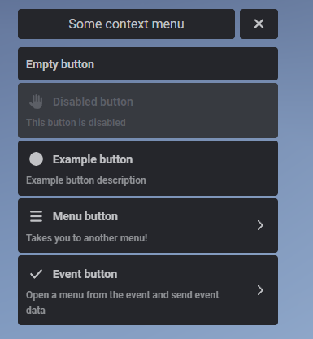
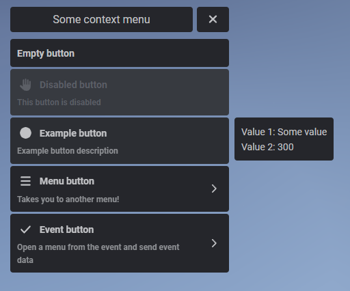
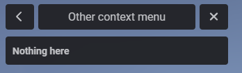
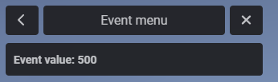

> Fuente original: https://github.com/overextended/docs/blob/328e36feb5b0486d6214971f53c6d2626193cc28/content/docs/ox_lib/Interface/Client/context.mdx · repositorio overextended/docs @ 328e36f · copiado el 2026-10-20

# Context Menu

## lib.registerContext

Used for registering a context menu.

**Lua**

```lua
lib.registerContext(context)
```

**JS**

```ts
import lib from '@overextended/ox_lib/client';

lib.registerContext(context);
```

- id: `string`
  - Unique menu identifier, will be used to open the menu.
- title: `string`
  - Title display in the menu; has markdown support.
- position?: `'top-left'` or `'top-right'` or `'bottom-left'` or `'bottom-right'`
  - Default: `'top-right'`
- menu?: `string`
  - Menu identifier - if defined there will be a back arrow next to the menu title that will take you to the menu you defined.
- canClose: `boolean`
  - If set to false the user won't be able to exit the menu without pressing one of the buttons.
- onExit?: `function`
  - Function that will be ran when the user closes their context menu with ESC.
- onBack?: `function`
  - Function that will be ran when the user presses the back button to return to a previous menu.
- options: `table` (`object` or `array`)
  - item: `key` (`string`) or `table` (`object`)
    - title?: `string`
      - If not using keys then sets the title for the button; has markdown support.
    - disabled?: `boolean`
      - Grays out the button and makes it unclickable.
    - readOnly? `boolean`
      - Removes all hover and active styles and disables onSelect if it's defined.
    - menu?: `string`
      - Menu identifier that the button will take you to, when defined an arrow.
    - onSelect: `function`
      - Function that's ran when the button is clicked.
    - icon?: `string`
      - FontAwesome icon that will be displayed on the left side, works the same as notification and textui icons.
      - Also supports image urls, png and webp files but are not recommend to use over font awesome icons.
    - iconColor?: `string`
      - Colour of the displayed icon.
    - iconAnimation?: `'spin'` `'spinPulse'` `'spinReverse'` `'pulse'` `'beat'` `'fade'` `'beatFade'` `'bounce'` `'shake'`
    - progress?: `number`
      - Adds a progress bar filled to this percentage
    - colorScheme?: `string`
      - Sets the color scheme of the progress bar. Current options can be found here:
        - https://v6.mantine.dev/theming/colors/#default-colors
        - For example: `blue` or `teal`
    - arrow?: `boolean`
      - Shows an arrow on the right side like `menu` does, useful when you are opening a menu from an event. Can be set to false to hide it.
    - description?: `string`
      - Description that will appear under the button title that is defined as a key; has markdown support.
    - image?: `string`
      - Url to an image that will be displayed in the button's metadata.
    - metadata?: `string[]` or `object` or `array`
      - Information that will display on the side upon hovering a button.
      - label: `string`
      - value: `any`
      - progress?: `number`
        - Display a progress bar in the metadata.
      - colorScheme?: `string`
        - Same as above.
    - event?: `string`
      - Event that the button is going to trigger.
    - serverEvent?: `string`
      - Server event that the button is going to trigger.
    - args?: `any`
      - Arguments that will be sent to the events or onSelect function.

You can register as many context menus in one `lib.registerContext` function
as you'd like.

The menu can be either in the order you write it in, or sorted alphabetically.  
To sort the menu alphabetically the buttons (and/or metadata) need to be defined as keys, otherwise not using keys and instead using tables will make the menu be in the order you define it as.

## lib.showContext

Opens a registered context menu by its id.

**Lua**

```lua
lib.showContext(id)
```

**JS**

```ts
import lib from '@overextended/ox_lib/client';

lib.showContext(id);
```

- id: `string`

## lib.hideContext

Hides any currently visible context menu.

**Lua**

```lua
lib.hideContext(onExit)
```

**JS**

```ts
import lib from '@overextended/ox_lib/client';

lib.hideContext(onExit);
```

- onExit: `boolean`
  - Defines whether the onExit function for the menu should be ran or not.

## lib.getOpenContextMenu

Returns the id of the currently open context menu.

If no context menu is open returns `nil`.

**Lua**

```lua
lib.getOpenContextMenu()
```

**JS**

```ts
import lib from '@overextended/ox_lib/client';

lib.getOpenContextMenu();
```

## Usage Example

First we register the menu with our specified options then we call the show function in the command.

> **Nota:** Avoid constantly re-registering a menu that does not depend on any outside values (A.K.A a static
> menu).

**Lua**

```lua
lib.registerContext({
  id = 'some_menu',
  title = 'Some context menu',
  position = 'top-right',
  options = {
    {
      title = 'Empty button',
    },
    {
      title = 'Disabled button',
      description = 'This button is disabled',
      icon = 'hand',
      disabled = true
    },
    {
      title = 'Example button',
      description = 'Example button description',
      icon = 'circle',
      onSelect = function()
        print("Pressed the button!")
      end,
      metadata = {
        {label = 'Value 1', value = 'Some value'},
        {label = 'Value 2', value = 300}
      },
    },
    {
      title = 'Menu button',
      description = 'Takes you to another menu!',
      menu = 'other_menu',
      icon = 'bars'
    },
    {
      title = 'Event button',
      description = 'Open a menu from the event and send event data',
      icon = 'check',
      event = 'test_event',
      arrow = true,
      args = {
        someValue = 500
      }
    }
  }
})
```

**JS**

```ts
import lib from '@overextended/ox_lib/client';

lib.registerContext({
  id: 'some_menu',
  title: 'Some context menu',
  position: 'top-right',
  options: [
    {
      title: 'Empty button',
    },
    {
      title: 'Disabled button',
      description: 'This button is disabled',
      icon: 'hand',
      disabled: true,
    },
    {
      title: 'Example button',
      description: 'Example button description',
      icon: 'circle',
      onSelect: () => {
        console.log('Pressed the button!');
      },
      metadata: [
        { label: 'Value 1', value: 'Some value' },
        { label: 'Value 2', value: 300 },
      ],
    },
    {
      title: 'Menu button',
      description: 'Takes you to another menu!',
      menu: 'other_menu',
      icon: 'bars',
    },
    {
      title: 'Event button',
      description: 'Open a menu from the event and send event data',
      icon: 'check',
      event: 'test_event',
      arrow: true,
      args: {
        someValue: 500,
      },
    },
  ],
});
```

Then we can also register our second menu called `other_menu`

**Lua**

  ```lua
  lib.registerContext({
    id = 'other_menu',
    title = 'Other context menu',
    menu = 'some_menu',
    onBack = function()
      print('Went back!')
    end,
    options = {
      {
        title = 'Nothing here'
      }
    }
  })
```

**JS**

```ts
lib.registerContext({
  id: 'other_menu',
  title: 'Other context menu',
  menu: 'some_menu',
  onBack: () => {
    console.log('Went back!');
  },
  options: [
    {
      title: 'Nothing here',
    },
  ],
});
```

And the event that we are going to run from the `some_menu` menu, which is going to open another menu.

**Lua**

```lua
RegisterNetEvent('test_event', function(args)
  lib.registerContext({
    id = 'event_menu',
    title = 'Event menu',
    menu = 'some_menu',
    options = {
      {
        title = 'Event value: '..args.someValue,
      }
    }
  })

  lib.showContext('event_menu')
end)
```

**JS**

```ts
onNet('test_event', (args: { someValue: number }) => {
  lib.registerContext({
    id: 'event_menu',
    title: 'Event menu',
    menu: 'some_menu',
    options: [
      {
        title: `Event value: ${args.someValue}`,
      },
    ],
  });

  lib.showContext('event_menu');
});
```

Lastly we register a test command to show the `some_menu` menu.

**Lua**

```lua
RegisterCommand('testcontext', function()
  lib.showContext('some_menu')
end)
```

**JS**

```ts
RegisterCommand('testcontext', () => {
  lib.showContext('some_menu');
});
```

The data from the `args` table in the menu is passed as a first argument to the event you register.

Using this event we also register a new context menu with it's own options.

By defining a `menu` param to be the id of the first menu we can get the back arrow button next to the menu title that will take us back.





