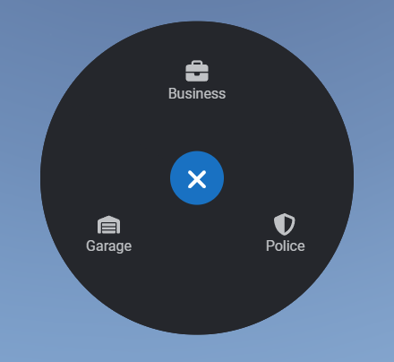

> Fuente original: https://github.com/overextended/docs/blob/328e36feb5b0486d6214971f53c6d2626193cc28/content/docs/ox_lib/Interface/Client/radial.mdx · repositorio overextended/docs @ 328e36f · copiado el 2026-10-20

# Radial Menu

- Radial menu has a global menu that's by default accessed with `z` and only displays when there is at least one item.
- You can add and remove items from the global menu using `lib.addRadialItem` and `lib.removeRadialItem`.
- Use `lib.registerRadial` for creating sub menus and use the `menu` property on the items to open those sub menus.

## lib.addRadialItem

Item or array of items added to the global radial menu, or to a sub menu if `parentMenuId` is specified.

**Lua**

```lua
lib.addRadialItem(items, parentMenuId)
```

**JS**

```ts
import lib from '@overextended/ox_lib/client';

lib.addRadialItem(items, parentMenuId);
```

- items: `table` (`object` or `array`)
  - id: `string`
    - Id that is used for removing options.
  - icon: `string`
    - Either a font awesome or a custom URI.1
  - iconWidth?: `number`
  - iconHeight?: `number`
    - In the case of a custom URI, adjust the size of the icon.
  - label: `string`
    - Label uses `  \n` to insert a newline
  - menu?: `string`
    - Id of a menu to open.
  - onSelect: `function(currentMenu: string | nil, itemIndex: number)` | `string`
    - Function that's ran when a user clicks the item.
  - keepOpen?: `boolean`
- parentMenuId?: `string`
  - If specified, adds the item(s) to the sub menu with this id instead of the global menu.

## lib.removeRadialItem

Id of an item to be removed from the global menu, or from a sub menu if `parentMenuId` is specified.

**Lua**

```lua
lib.removeRadialItem(id, parentMenuId)
```

**JS**

```ts
import lib from '@overextended/ox_lib/client';

lib.removeRadialItem(id, parentMenuId);
```

- id: `string`
- parentMenuId?: `string`
  - If specified, removes the item from the sub menu with this id instead of the global menu.

## lib.clearRadialItems

Removes all items from the radial menu.

**Lua**

```lua
lib.clearRadialItems()
```

**JS**

```ts
import lib from '@overextended/ox_lib/client';

lib.clearRadialItems();
```

## lib.registerRadial

Registers a radial sub menu with predefined options.

**Lua**

```lua
lib.registerRadial(radial)
```

**JS**

```ts
import lib from '@overextended/ox_lib/client';

lib.registerRadial(radial);
```

- radial: `table` (`object`)
  - id: `string`
    - Unique menu id used to open with `menu` prop on an item.
  - items: `array`
    - icon: `string`
    - label: `string`
      - Label uses `  \n` to insert a newline
    - menu?: `string`
      - Id of a menu to open.
    - onSelect?: `function(currentMenu: string | nil, itemIndex: number)` | `string`
      - Function that's ran when a user clicks the item.

## lib.showRadialMenu

Opens a registered radial menu as the root radial menu.

**Lua**

```lua 
lib.showRadialMenu(id)
```

**JS**

```ts
import lib from '@overextended/ox_lib/client';

lib.showRadialMenu(id);
```

- id: string
  - Unique menu id from registered radial menus.

## lib.hideRadial

Hides the radial menu if one is open.

**Lua**

```lua
lib.hideRadial()
```

**JS**

```ts
import lib from '@overextended/ox_lib/client';

lib.hideRadial();
```

## lib.disableRadial

Disallow players from opening the radial menu.

**Lua**

```lua
lib.disableRadial(state)
```

**JS**

```ts
import lib from '@overextended/ox_lib/client';

lib.disableRadial(state);
```

- state: `boolean`
  - Whether or not radial menu should be disabled

## lib.getCurrentRadialId

Returns the id of the currently open radial menu.

**Lua**

```lua
local id = lib.getCurrentRadialId()
```

**JS**

```ts
import lib from '@overextended/ox_lib/client';

let id = lib.getCurrentRadialId();
```

## Usage Example

> **Nota:** When adding radial menu items whether they are global or for a sub menu, make sure to stick to
> short as possible labels as long labels will look out of place and should not be used with the
> radial menu because of its density.

Here's a use case example with some global options and an option utilising the lib's points system.

**Lua**

```lua
exports('myMenuHandler', function(menu, item)
    print(menu, item)

    if menu == 'police_menu' and item == 1 then
        print('Handcuffs')
    end
end)

lib.registerRadial({
  id = 'police_menu',
  items = {
    {
      label = 'Handcuff',
      icon = 'handcuffs',
      onSelect = 'myMenuHandler'
    },
    {
      label = 'Frisk',
      icon = 'hand'
    },
    {
      label = 'Fingerprint',
      icon = 'fingerprint'
    },
    {
      label = 'Jail',
      icon = 'bus'
    },
    {
      label = 'Search',
      icon = 'magnifying-glass',
      onSelect = function()
        print('Search')
      end
    }
  }
})

lib.addRadialItem({
  {
    id = 'police',
    label = 'Police',
    icon = 'shield-halved',
    menu = 'police_menu'
  },
  {
    id = 'business_stuff',
    label = 'Business',
    icon = 'briefcase',
    onSelect = function()
      print("Business")
    end
  }
})

local coords = GetEntityCoords(cache.ped)
local point = lib.points.new(coords, 5)

function point:onEnter()
  lib.addRadialItem({
    id = 'garage_access',
    icon = 'warehouse',
    label = 'Garage',
    onSelect = function()
      print('Garage')
    end
  })
end

function point:onExit()
  lib.removeRadialItem('garage_access')
end
```

**JS**

> **Nota:** Points system in the lib isn't available for the npm package.

    ```ts
    import lib from '@overextended/ox_lib/client'

    exports('myMenuHandler', (menu, item) => {
        console.log(menu, item)

        if (menu === 'police_menu' and item === 1) {
            console.log('Handcuffs')
        }
    })

    lib.registerRadial({
      id: 'police_menu',
      items: [
        {
          label: 'Handcuff',
          icon: 'handcuffs',
          onSelect: 'myMenuHandler'
        },
        {
          label: 'Frisk',
          icon: 'hand'
        },
        {
          label: 'Fingerprint',
          icon: 'fingerprint'
        },
        {
          label: 'Jail',
          icon: 'bus'
        },
        {
          label: 'Search',
          icon: 'magnifying-glass',
          onSelect: () => {
            console.log('Search')
          }
        }
      ]
    })

    lib.addRadialItem([
      {
        id: 'police',
        label: 'Police',
        icon: 'shield-halved',
        menu: 'police_menu'
      },
      {
        id: 'business_stuff',
        label: 'Business',
        icon: 'briefcase',
        onSelect: () => {
          console.log('Business')
        }
      }
    ])
    ```



