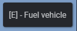
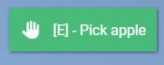

> Fuente original: https://github.com/overextended/docs/blob/328e36feb5b0486d6214971f53c6d2626193cc28/content/docs/ox_lib/Interface/Client/textui.mdx · repositorio overextended/docs @ 328e36f · copiado el 2026-10-20

# TextUI

## lib.showTextUI

Show the TextUI window.

> **Advertencia:** **DO NOT** run this function every tick, it's intended to be used as a toggle.

**Lua**

```lua
lib.showTextUI(text, options)
```

**JS**

```ts
import lib from '@overextended/ox_lib/client';

lib.showTextUI(text, options);
```

- text: `string`
- options?: `table`
  - position?: `'right-center'` or `'left-center'` or `'top-center'` or `'bottom-center'`
    - Default: `'right-center'`
  - icon?: `string` or `table` (`array`)
  - iconColor?: `string`
  - iconAnimation?: `'spin'` `'spinPulse'` `'spinReverse'` `'pulse'` `'beat'` `'fade'` `'beatFade'` `'bounce'` `'shake'`
  - style?: React.CSSProperties
  - alignIcon?: `'top'` or `'center'`
    - Default: `'center'`

## lib.hideTextUI

Hides the currently visible TextUI window

**Lua**

```lua
lib.hideTextUI()
```

**JS**

```ts
import lib from '@overextended/ox_lib/client';

lib.hideTextUI();
```

## lib.isTextUIOpen

Returns whether Text UI is opened or not. The currently displayed text is returned as the second value.

**Lua**

```lua
local isOpen, text = lib.isTextUIOpen()
```

**JS**

```ts
import lib from '@overextended/ox_lib/client';

const [isOpen, text] = lib.isTextUIOpen();
```

## Usage Example

### Basic

**Lua**

```lua
lib.showTextUI('[E] - Fuel vehicle')
```

**JS**

```ts
import lib from '@overextended/ox_lib/client';

lib.showTextUI('[E] - Fuel vehicle');
```



### Custom styling

**Lua**

```lua
lib.showTextUI('[E] - Pick apple', {
    position = "top-center",
    icon = 'hand',
    style = {
        borderRadius = 0,
        backgroundColor = '#48BB78',
        color = 'white'
    }
})
```

**JS**

```ts
import lib from '@overextended/ox_lib/client';

lib.showTextUI('[E] - Pick apple', {
  position: 'top-center',
  icon: 'hand',
  style: {
    borderRadius: 0,
    backgroundColor: '#48BB78',
    color: 'white',
  },
});
```


