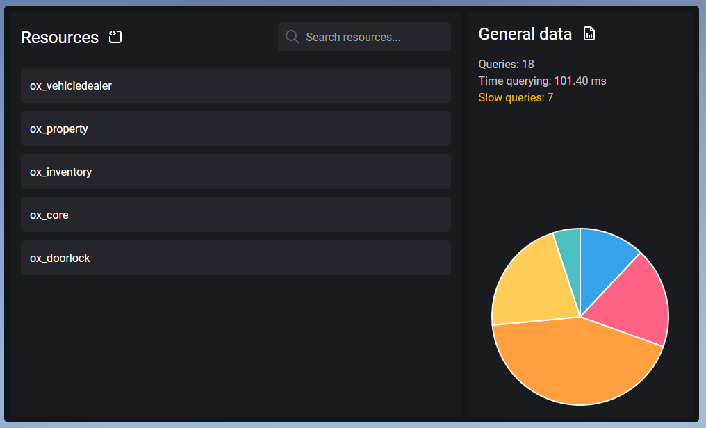
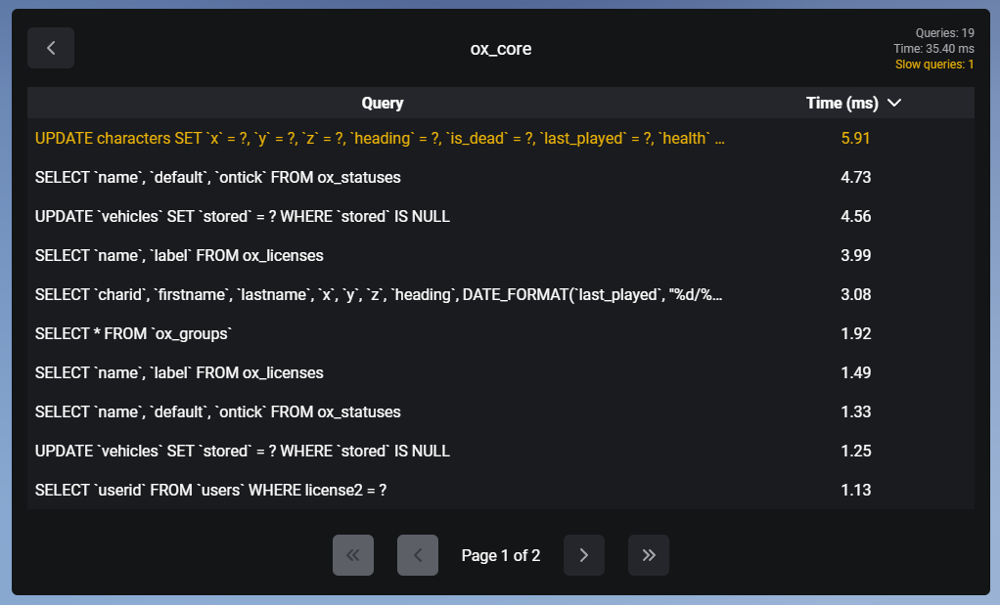

> Fuente original: https://github.com/overextended/docs/blob/328e36feb5b0486d6214971f53c6d2626193cc28/content/docs/oxmysql/ui.mdx · repositorio overextended/docs @ 328e36f · copiado el 2026-10-20

# Using the Debug UI

The debug UI lets you easily see all the queries that have been executed by resources, query response times, and per-resource statistics.
You should only enable this during development, or with a small player count - for larger servers, look into builtin MySQL logging.

Before using the UI first you have to make sure you have the `mysql_ui` convar set to true:

```bash
set mysql_ui true
```

Also make sure that you have `command` or `command.mysql` ace permission access, then you should be able to use the `mysql` command in game.

> **Nota:** You _do not_ need to have the `mysql_debug` enabled to use the debug ui.

## Main page

The main page shows you the resources that ran queries where you can filter them through a search bar, your general data
along side a pie chart which shows what resources took the most query time.



## Resource page

The resource page shows you all the queries and their execution time inside a table that the resource previously ran,
alongside the total amount of the queries, execution time and slow queries for the selected resource.

Columns can be sorted by ascending and descending order, and hovering over a query will display the full query inside a tooltip.

> **Nota:** Queries that exceed `mysql_slow_query_warning` (default 150ms) are displayed in orange.  
> For demonstation purposes the `mysql_slow_query_warning` convar was set to 5 here.


