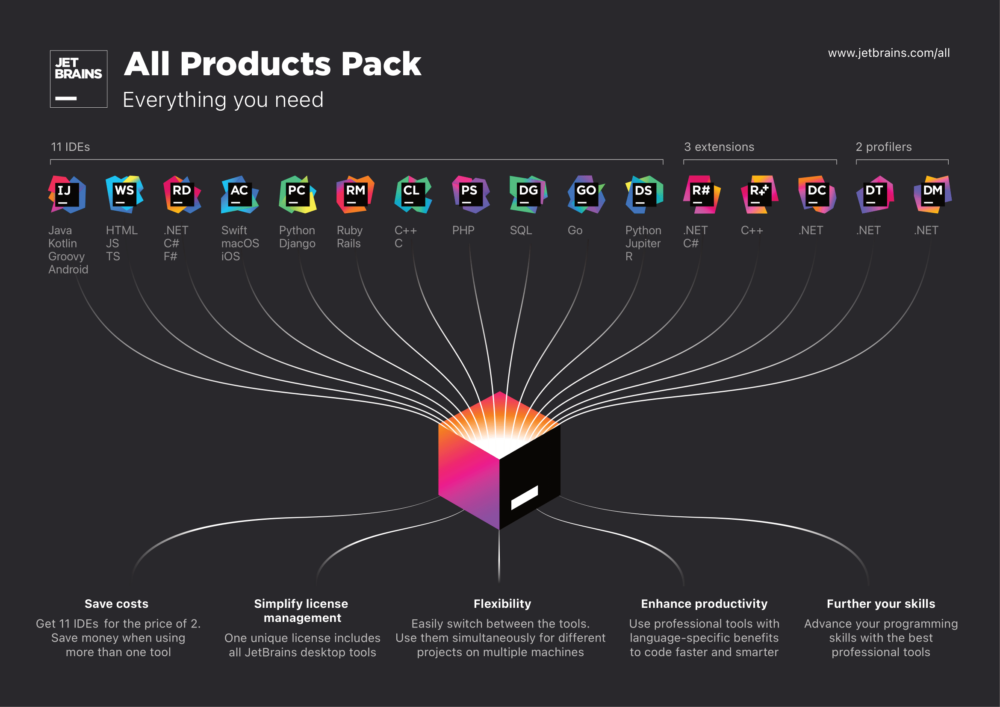

> Fuente original: https://github.com/qbcore-framework/qb-docs/blob/930c12ec4f60dfbba60253571f1a58980129516d/README.md · repositorio qbcore-framework/qb-docs @ 930c12e · copiado el 2026-10-20

# ✍ JetBrains

*Whichever technologies you use, there's a JetBrains tool to match!*

## Who are they?

JetBrains is a software company that specializes in creating developer tools. [Here](https://www.jetbrains.com/products/) is a list of them! Their products are used by some of the best-known companies such as Google, NASA, Valve, Netflix, Ubisoft, Twitter & more!&#x20;

## Documentation

> **Contenido incrustado:** [https://www.jetbrains.com/help/](https://www.jetbrains.com/help/)

## Products

> **Contenido incrustado:** [https://www.jetbrains.com/store/#personal](https://www.jetbrains.com/store/#personal)
