> Fuente original: https://github.com/qbcore-framework/qb-docs/blob/930c12ec4f60dfbba60253571f1a58980129516d/guides/windows-installation.md · repositorio qbcore-framework/qb-docs @ 930c12e · copiado el 2026-10-20

# 🪟 Windows Installation

*Installing a QBCore server step by step.*

## Database Configuration

Install [MariaDB](https://mariadb.org/download)and [HeidiSQL](https://www.heidisql.com/download.php)

## MariaDB

## HeidiSQL

* Open HeidiSQL, click the green circle with the plus sign and name it something

> **Consejo:** The names don't matter, you can name them whatever you want!

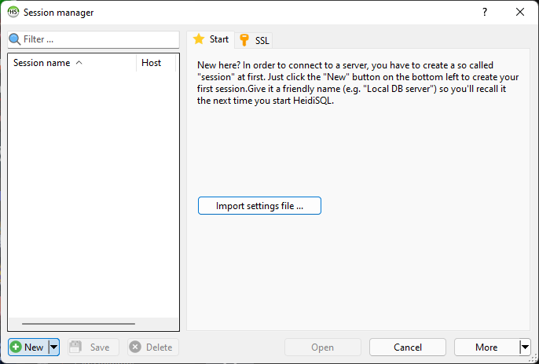

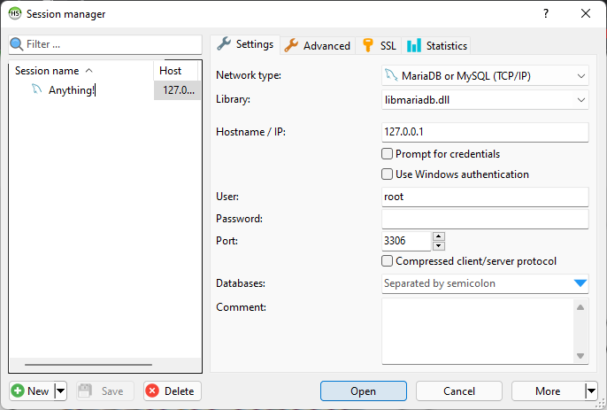

## Artifact and txAdmin

Make a new folder on your desktop and name it whatever you want, download the **latest recommended** FiveM [artifacts](https://runtime.fivem.net/artifacts/fivem/build\_server\_windows/master/), then extract them to the folder you made

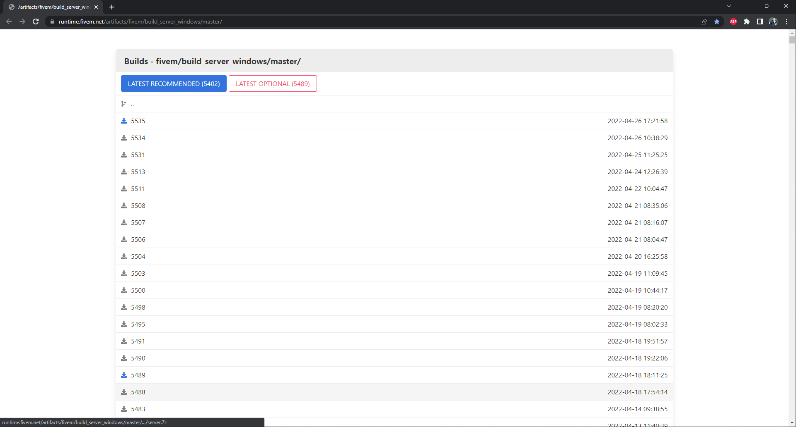

Double click on FXServer.exe to run it. Once loaded, it should open a web browser page

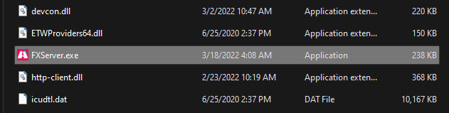

After you link your FiveM account, which it should do automatically, make a password. Then you will be greeted with steps

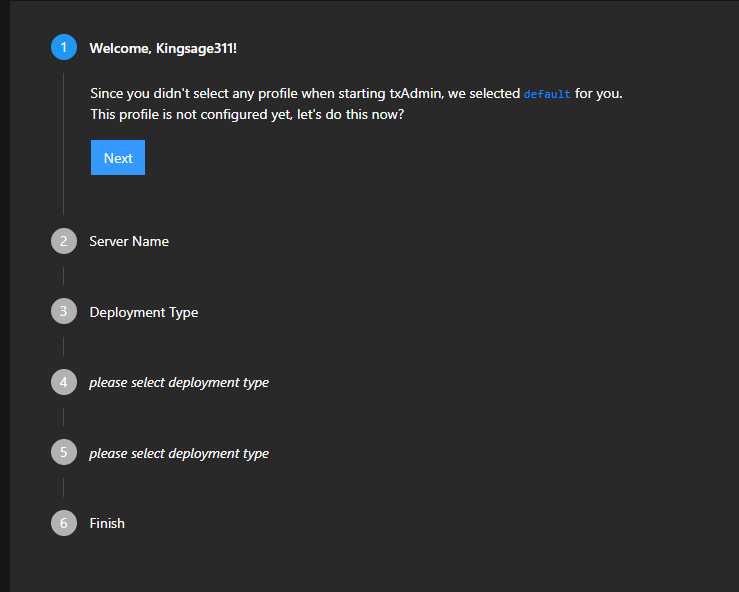

When you get to step number 3, click "Popular Template" then "QBCore Framework"

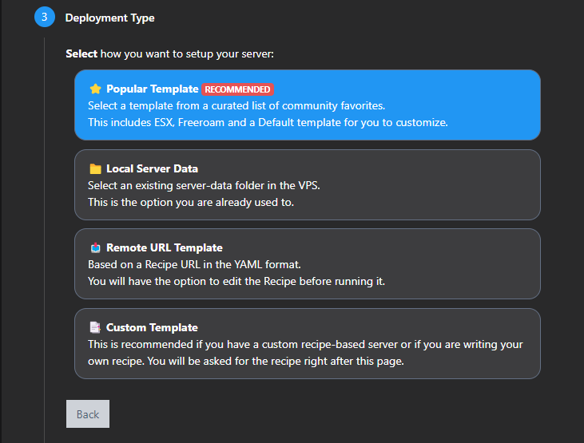

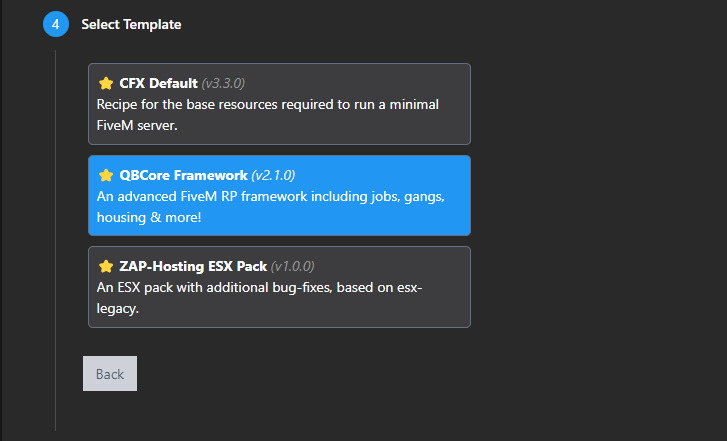

Select a folder you would like to store your server data in.

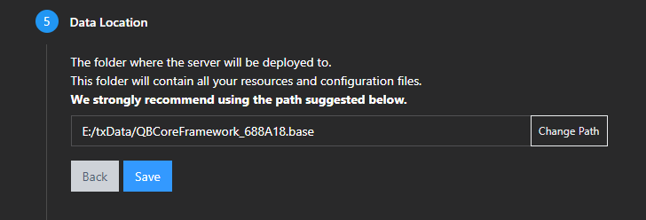

Scroll to the bottom and run the recipe deployer

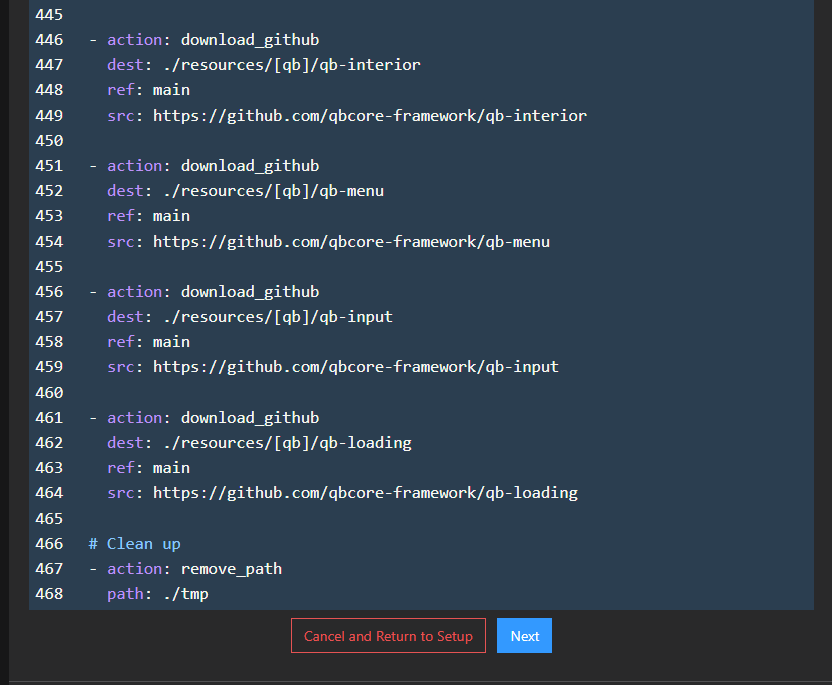

Go to [keymaster](https://keymaster.fivem.net/) and generate a key. Fill out that information correctly.

> **Nota:** Keymaster keys only require the IP address the first time it launches after that the generated key can be used on any IP.

Paste your Keymaster key where prompted.

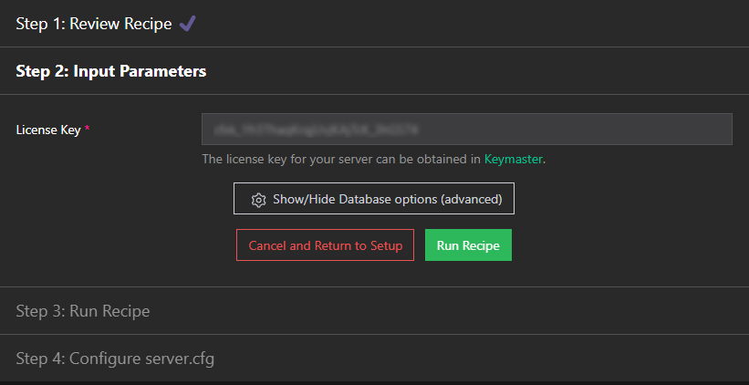

Then click "Run Recipe"

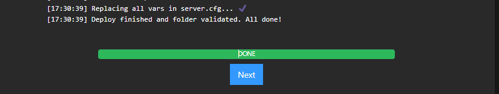

> **Peligro:** If you did not get the above message and got an error message, please use the official [QBCore Discord](https://discord.gg/qbcore) and post in [fivem-support](https://discord.com/channels/831626422232678481/1006299568314527895)

> **Advertencia:** Let yarn install all the way through on the initial startup.

Once this is complete, we recommend visiting [setting-permissions.md](setting-permissions.md) to configure your server.cfg with any players you'd like to give elevated permissions!
