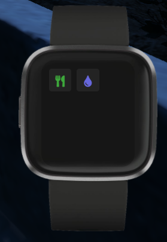

> Fuente original: https://github.com/qbcore-framework/qb-docs/blob/930c12ec4f60dfbba60253571f1a58980129516d/qbcore-resources/qb-fitbit.md · repositorio qbcore-framework/qb-docs @ 930c12e · copiado el 2026-10-20

# ⌚ qb-fitbit

*Gotta get them steps in!*

## Introduction

Makes an item in-game named "fitbit" on use it shows a NUI that the user can set levels for hunger/thirst levels and when the user hits the alert threshold this resource makes a sound and alerts the player via a chat message

> **Consejo:** This resource has no configuration file or dependencies other than qb-core

## Preview

