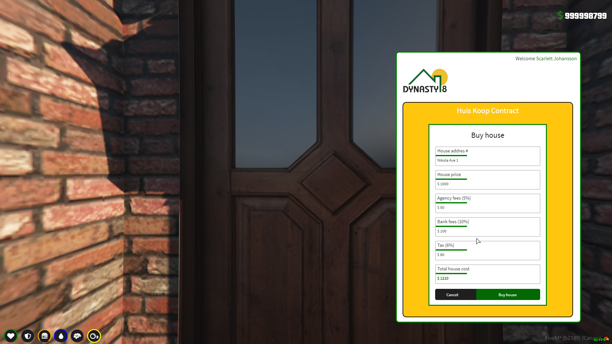
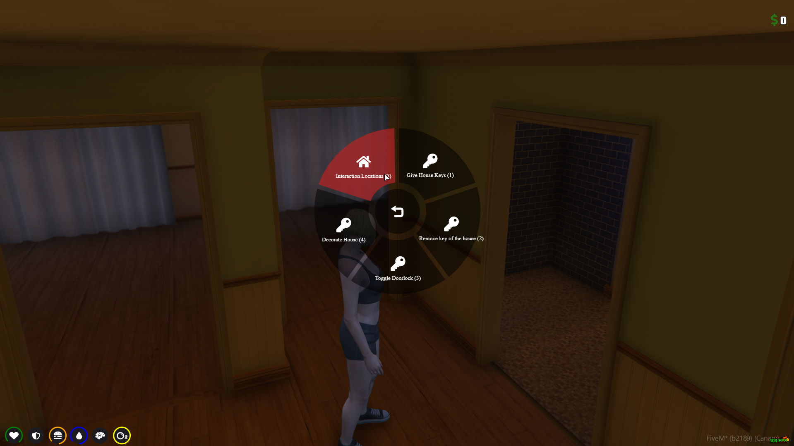

> Fuente original: https://github.com/qbcore-framework/qb-docs/blob/930c12ec4f60dfbba60253571f1a58980129516d/qbcore-resources/qb-houses.md · repositorio qbcore-framework/qb-docs @ 930c12e · copiado el 2026-10-20

# 🏡 qb-houses

*Buy & customize your dream home!*

## Introduction

* Allows players to purchase homes that are created by those with the real-estate job. They can decorate them, have a personal garage and share keys with their friends

> **Consejo:** By default, this resource uses the 16 free shells found in [qb-interior.md](qb-interior.md)

## Preview






## Configuration

### Generic

```lua
Config = {}
Config.MinZOffset = 30 -- how far under the ground shells will spawn
Config.RamsNeeded = 2 -- how many stormram items are needed to raid a house
Config.UnownedBlips = false -- enable/disable unowned house blips on the map
Config.Houses = {} -- populates automatically on server start
Config.Targets = {} -- populates automatically on server start
Config.Furniture = {} -- pre-filled with tons of options
```

### Shells

* Found in qb-houses/client/main.lua at line 697

```lua
local function getDataForHouseTier(house, coords)
```

## Commands

* /decorate - Allows the player decorate the house
* /createhouse \[price] \[tier] - Creates a house and saves it to database
* /addgarage - Adds a garage to nearby house
* /enter - Enters the nearby house
* /ring - Rings the bell of nearby house

## Items

* police\_stormram - Allows on-duty police to enter and search a player's home
