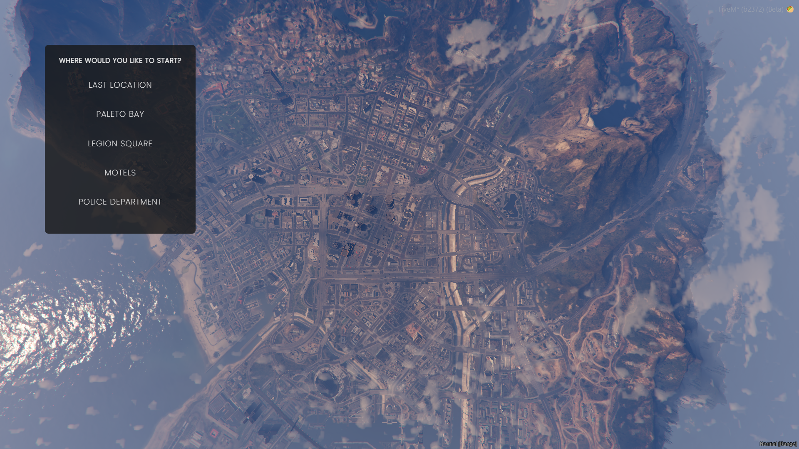

> Fuente original: https://github.com/qbcore-framework/qb-docs/blob/930c12ec4f60dfbba60253571f1a58980129516d/qbcore-resources/qb-spawn.md · repositorio qbcore-framework/qb-docs @ 930c12e · copiado el 2026-10-20

# 🗺 qb-spawn

*Instant transmission*

## Introduction

* Configure multiple spawn locations for players to choose from and auto populates their houses that they own

## Preview



## Configuration

```lua
QB.Spawns = {
    ["legion"] = { -- Index for the table
        coords = vector4(195.17, -933.77, 29.7, 144.5), -- Where player spawns
        location = "legion", -- this is how the javascript knows which you picked
        label = "Legion Square", -- What the player sees in the menu
    },

    ["policedp"] = {
        coords = vector4(428.23, -984.28, 29.76, 3.5),
        location = "policedp",
        label = "Police Department",
    },

    ["paleto"] = {
        coords = vector4(80.35, 6424.12, 31.67, 45.5),
        location = "paleto",
        label = "Paleto Bay",
    },

    ["motel"] = {
        coords = vector4(327.56, -205.08, 53.08, 163.5),
        location = "motel",
        label = "Motels",
    },
```
