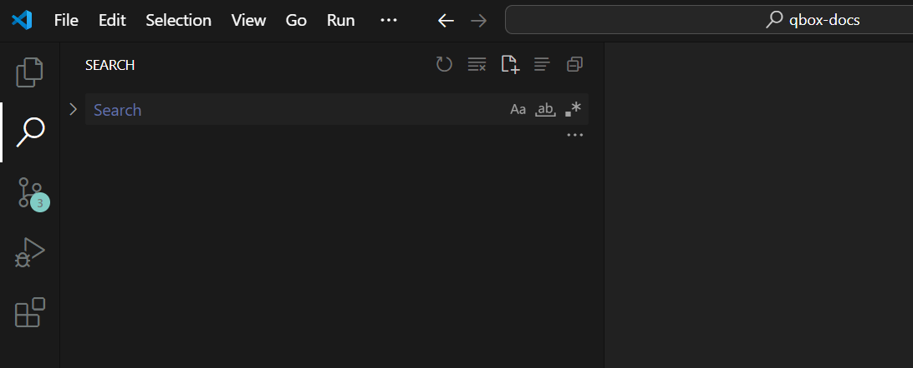
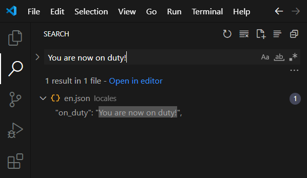
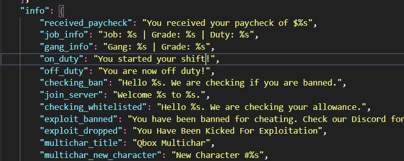
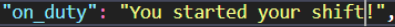
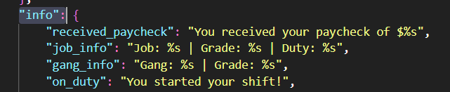
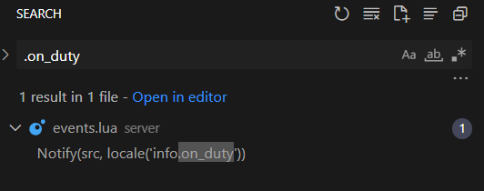
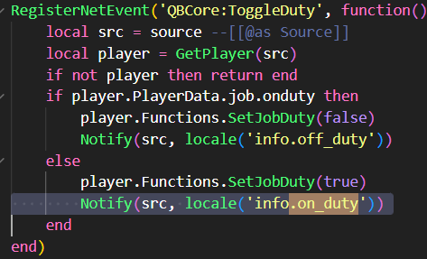

> Fuente original: https://github.com/Qbox-project/qbox-docs/blob/260c0ecedce58bece2cf94ebef73be42d08258ac/blog/2025/09-05-navigating.mdx · repositorio Qbox-project/qbox-docs @ 260c0ec · copiado el 2026-10-20

# Navigating Qbox Efficiently

*Learn how to efficiently explore and manage Qbox by using your editor's search features.*

*Autores: ilomilo*

Working inside Qbox can sometimes feel overwhelming. Whether you need to remove a bugged item, locate a specific message, or figure out where certain data is stored, this guide will show you how to quickly find what you’re looking for.

## Why Navigation Matters in Qbox

A frequent set of questions from the Discord community:

> - “How do I remove this message?”
> - “Where is this item stored?”
> - “How can I change that label?”

The solution is almost always the same:
👉 **Use your editor’s Global Search.**

---

## Using Global Search in VSCode

Most developers working with Qbox use **Visual Studio Code**. For this guide, we’ll focus on VSCode’s built-in search.

The default keybinding to search across the entire project is:

```
CTRL + SHIFT + F
```

This opens a search input where you can type any string to quickly locate references throughout your project.



---

## Example: Changing a Message

Let’s say you want to change the message:

```
"You are now on duty!"
```

into:

```
"You started your shift!"
```

1. Press **CTRL + SHIFT + F** and enter the original text.

   

2. VSCode will show you exactly where this text appears. Open the file and update it.

   

3. Save your changes and restart the script. Done!

## Example: Removing a Message

Sometimes you don’t just want to change a message. Instead, you want to remove it entirely.

Most Qbox scripts support multiple languages, which means you’ll often be editing **translation files** instead of the direct script. This can feel confusing, because the place where the message is triggered is different from where the text itself is defined.

Take this example:



The blue text is the **translation key**. That’s how the script calls the message. To track down where this key is used, simply **search for the key name** in your project.

But sometimes keys are **nested**, like this one with the prefix `info`:



In this case, you can add a **dot prefix** before the key when searching, so only this specific value shows up:



This way, you can quickly identify exactly where and how the message is being used, and safely remove it.



---

## Final Thoughts

Mastering global search will save you countless hours and questions in Qbox. Instead of digging through folders manually, you’ll be able to instantly locate and edit the messages, items, or data you need.
This concept works for almost anything you’re trying to find in your project but following labels or keys often gives you the clearest path to the right spot.
