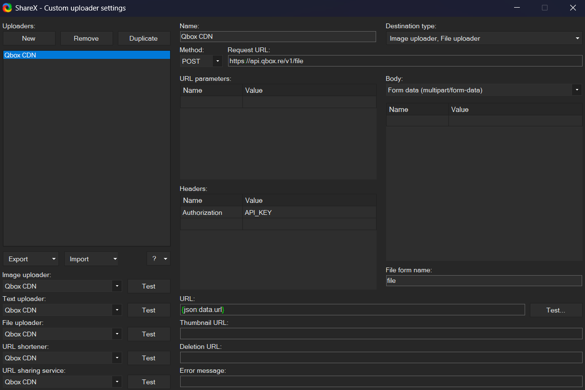
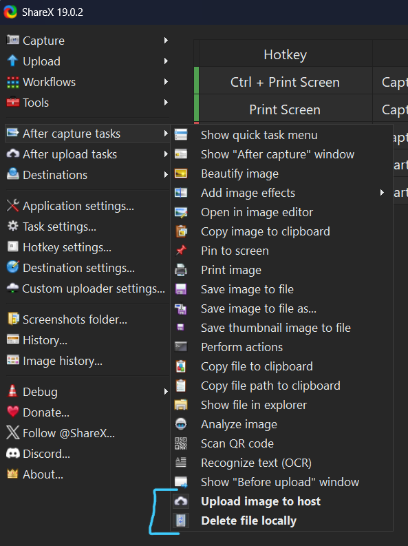
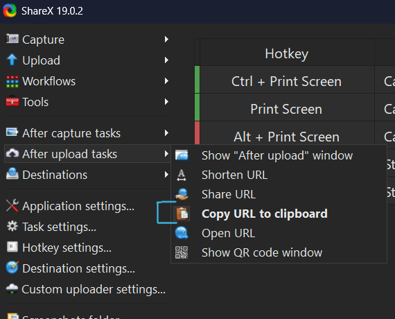
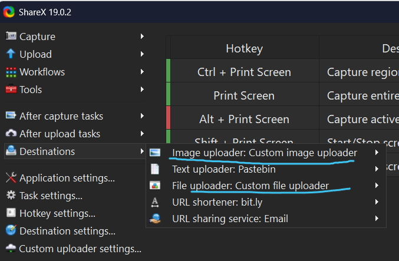

> Fuente original: https://github.com/Qbox-project/qbox-docs/blob/260c0ecedce58bece2cf94ebef73be42d08258ac/docs/dashboard/cdn/setup/sharex.mdx · repositorio Qbox-project/qbox-docs @ 260c0ec · copiado el 2026-10-20

# ShareX

## Custom Uploader Settings

Open ShareX and select `Custom uploader settings...` from the sidebar. Create a new uploader with the following values:

- Destination type: Image uploader, File uploader
- Method: POST
- Request URL: https://api.qbox.re/v1/file
- Body: Form data (multipart/form-data)
- Header:
  - Name: `Authorization`
  - Value: `YOUR_API_KEY_FROM_DASHBOARD`
- File form name: `file`
- URL: `{json:data.url}`

## ShareX Setup

- Under `After capture tasks`, select only:
  - `Upload image to host`
  - `Delete file locally`
- Under `After upload tasks`, select only:
  - `Copy URL to clipboard`
- Under `Destinations`, set both `Image` and `File` to `Custom uploader`

Now each time you make a screenshot or recording your own storage space won't be filled up and the corresponding URL will be copied into your clipboard for you to paste anywhere you like.

  
  
  

