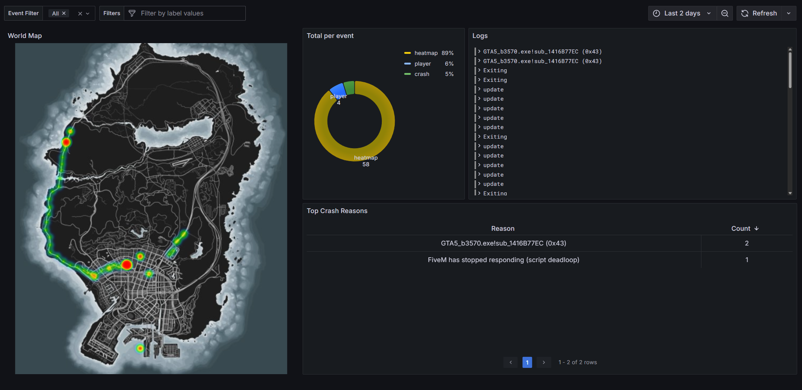
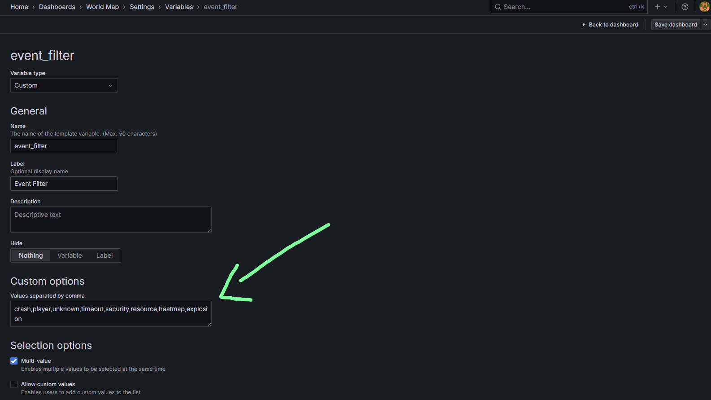
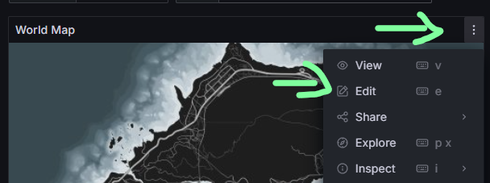
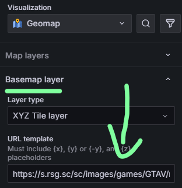

> Fuente original: https://github.com/Qbox-project/qbox-docs/blob/260c0ecedce58bece2cf94ebef73be42d08258ac/docs/dashboard/logging/geomap.mdx · repositorio Qbox-project/qbox-docs @ 260c0ec · copiado el 2026-10-20

# GTA V Map

Another great feature of Grafana is the ability to visualize your data on a map. This is especially useful for FiveM in case you want to visually see where something happened.

> **Nota:** Out of the box, this resource will log all player disconnections. This includes normal ones and crashes etc. It will also log all explosions on your server.

> **Advertencia:** There is also a piece of commented out code to log **all** player's locations every 15 seconds. Depending on your server size, this can lead to a **ton** of logs and thus more than likely degraded performance. Use at your own risk!



## Setup

We have a premade resource for the example above to get you started. You can find it on our [GitHub](https://github.com/Qbox-project/qbx_grafana_map).
You can install it anywhere you want. But in this case just drop it in the `[qbx]` folder with the rest!

Now to actually visualize the logs this resource produces, we will need to make a new dashboard in Grafana.
If you haven't noticed already, the resource also includes a `geomap.json` file. Copy the contents of this file and go to your Grafana Dashboards tab.
In the top right corner you'll see a big blue button `New`. Click it and select `Import` from the dropdown menu. Now paste the contents of the `geomap.json` file into the text area and click `Load` and `Import`.
And there it is! Your brand new geomap dashboard.

> **Vídeo:** [https://media.qbox.re/video/c6wX8jrRqNp3uNgGN_93OCvgrutgIwzy.mp4](https://media.qbox.re/video/c6wX8jrRqNp3uNgGN_93OCvgrutgIwzy.mp4)

## Alternative Usage

Like anything, these are just some examples on how you can use the geomap. Since everything is open source and customizable, you can change the resource to your liking, change the Grafana dashboard, everything! Yippie!
As you may have noticed, there is an event filter at the top of the page. So if you are going to use this dashboard for different use cases, you'll need to add your events in this filter.

1. Enter edit mode in the top right
2. Click on the `settings` button
3. Go to the `Variables` tab
4. Under `Custom Options` add your custom events, separated by a comma


Now for actually logging your event, we'll have to add a little something to the `ox_lib` logger function. The world coordinates don't overlap with the geomap coordinates. You have to convert them first,
for this we have exposed a small function in the `qbx_grafana_map` resource to convert them for you.
```lua
    local coords = GetEntityCoords(PlayerPedId())
    local lon, lat = exports.qbx_grafana_map:gameToMap(coords.x, coords.y)
    lib.logger(playerSource, 'custom_event', 'custom_message', ('lon:%s'):format(lon), ('lat:%s'):format(lat))
```
The important part is the `lon` and `lat` values. These are the converted coordinates that you can use in your logger function. Always include these as extra arguments! Otherwise the geomap will not know where the log took place.

## I want a different map!

Luckily for you this is possible and we have 3 maps to choose from! Hover over the map and click on the 3 dots and then `Edit`. Now on the right side under `Basemap layer` you can change the URL template to the following 3 options.





`https://s.rsg.sc/sc/images/games/GTAV/map/render/{z}/{x}/{y}.jpg`

`https://s.rsg.sc/sc/images/games/GTAV/map/game/{z}/{x}/{y}.jpg`

`https://s.rsg.sc/sc/images/games/GTAV/map/print/{z}/{x}/{y}.jpg`
