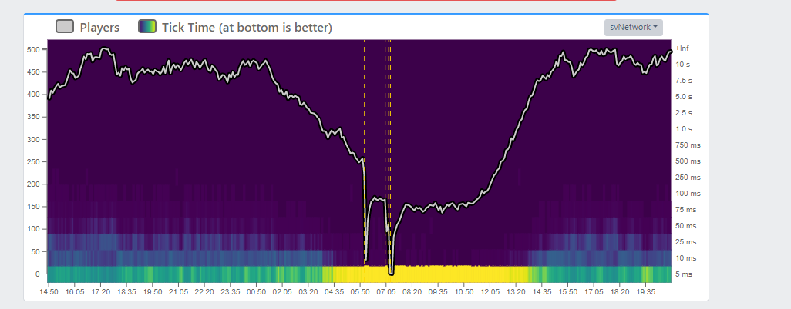
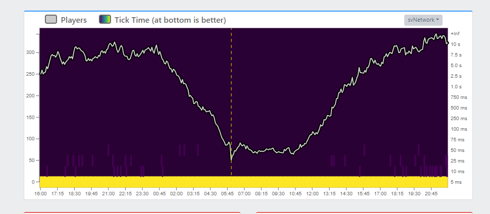

> Fuente original: https://github.com/Qbox-project/qbox-docs/blob/260c0ecedce58bece2cf94ebef73be42d08258ac/docs/dashboard/zumble/index.mdx · repositorio Qbox-project/qbox-docs @ 260c0ec · copiado el 2026-10-20

# 🎙️ Zumble

[Zumble](https://github.com/AvarianKnight/rust-mumble) is a managed [Mumble](https://www.mumble.info/) voice server tuned for FiveM.
It is a drop-in replacement for the default Mumble server bundled with FXServer, optimized for how FiveM actually uses voice: small audio packets, hundreds of channels created and removed per minute, and constant player movement in and out of proximity.

## Why a managed Mumble server

FXServer's bundled Mumble server works, but it is heavily limited by the TCP server. This often causes the well-known robotic voice effect at higher player counts.
Using an external Mumble server resolves these issues and can significantly reduce pressure on your FXServer network thread, freeing resources for other server tasks.

**Before**



**After**



## Which plans include it

Zumble is included in the **Duck** and **Qboxxer** plans. On other plans the Zumble page shows "Zumble is not included in your plan". See [plans](../index.md#plans).

## Setup

Open the **Zumble** page in the Qbox Dashboard. The first time you visit, press **Provision Zumble**.
After the server is running, press **Show server.cfg** on the **Managed Zumble** card to copy the three convars required by FXServer:

```bash
setr voice_externalAddress "<your-zumble-host>"
setr voice_externalPort <your-zumble-port>
setr voice_hideEndpoints 1
```

Paste these into your `server.cfg`, restart your FiveM server, and your existing voice resource (pma-voice, saltychat, etc.) will route through Zumble automatically. No resource changes are required.

> **Consejo:** You can paste these lines one by one into your server console, and all connected clients will automatically reconnect to Zumble without a full server restart.
> You should still add them to `server.cfg` so they persist after your next restart.

## Managing the server

The **Managed Zumble** card shows the server's status, port, and address. Its buttons:

| Button | What it does |
| --- | --- |
| **Show server.cfg** | Shows the three lines for your `server.cfg` |
| **Provision / Reconcile now** | A repair pass that puts the server back to the managed settings. It overwrites any manual changes. |
| **Start**, **Stop**, **Restart** | Turns the voice server on, off, or restarts it |

The **Usage snapshot** card shows the server's current **Memory**, **CPU**, and **Disk** use.

## Scheduled restart

Zumble should be restarted daily. On busy servers, repeated client connects can cause the session ID counter to keep climbing until the service becomes unstable or crashes.

> **Advertencia:** A daily Zumble restart is required for long-running servers. Without it, voice may eventually fail after enough client reconnects.

Open the Zumble page in the Qbox Dashboard and use the **Scheduled restart** card:

1. Choose a **Daily restart hour**. Times are shown in your browser timezone, and the hour defaults to 12:00 in your timezone.
2. Turn **Enabled** on.
3. Press **Save schedule**.

To turn the daily restart off, press **Remove schedule**.

> **Consejo:** Schedule Zumble to restart at the same time your FXServer restarts. Players are already disconnecting during the FXServer restart, so voice comes back cleanly when both services start again together.
